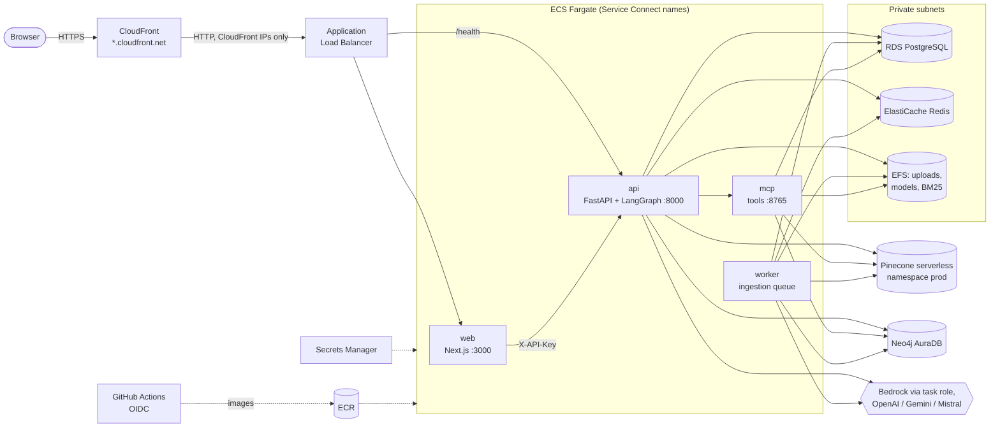
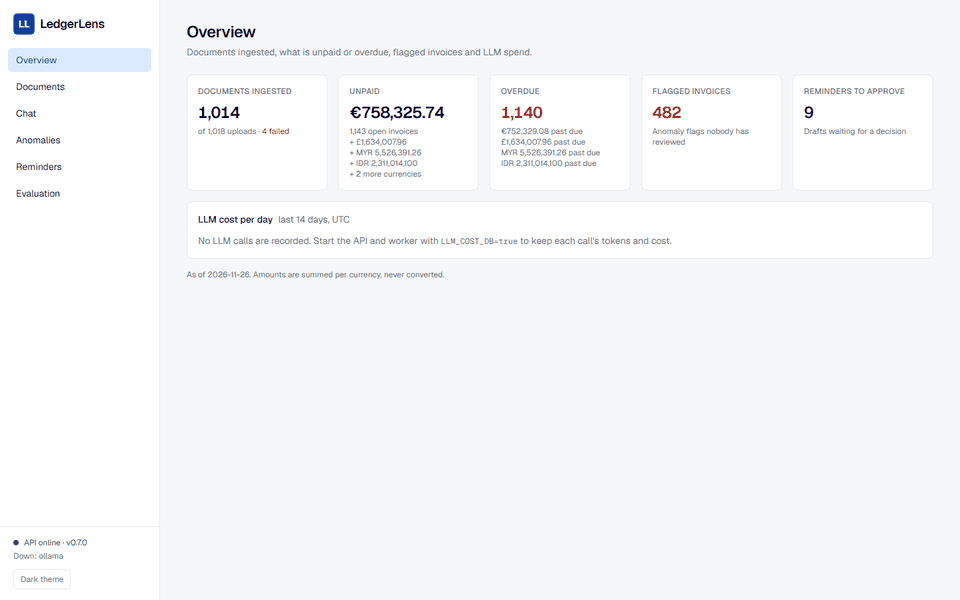
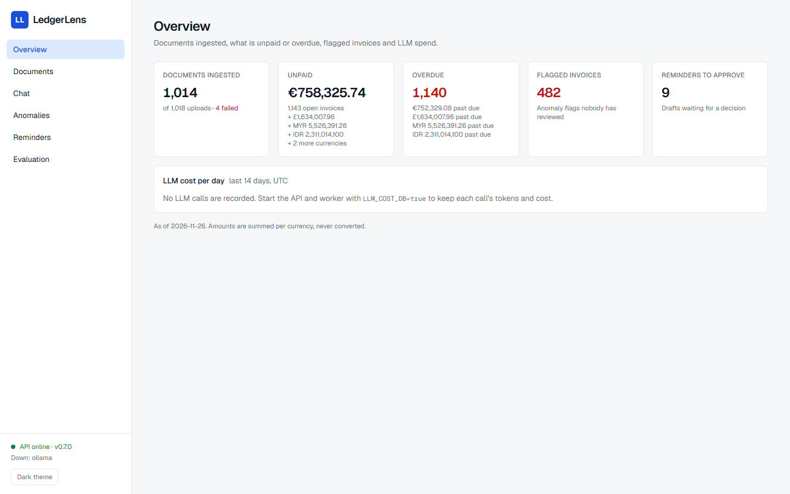
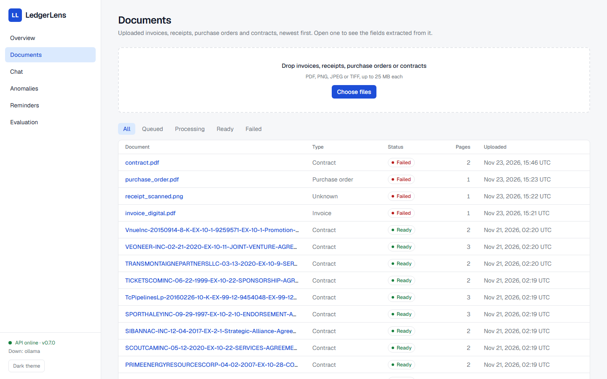
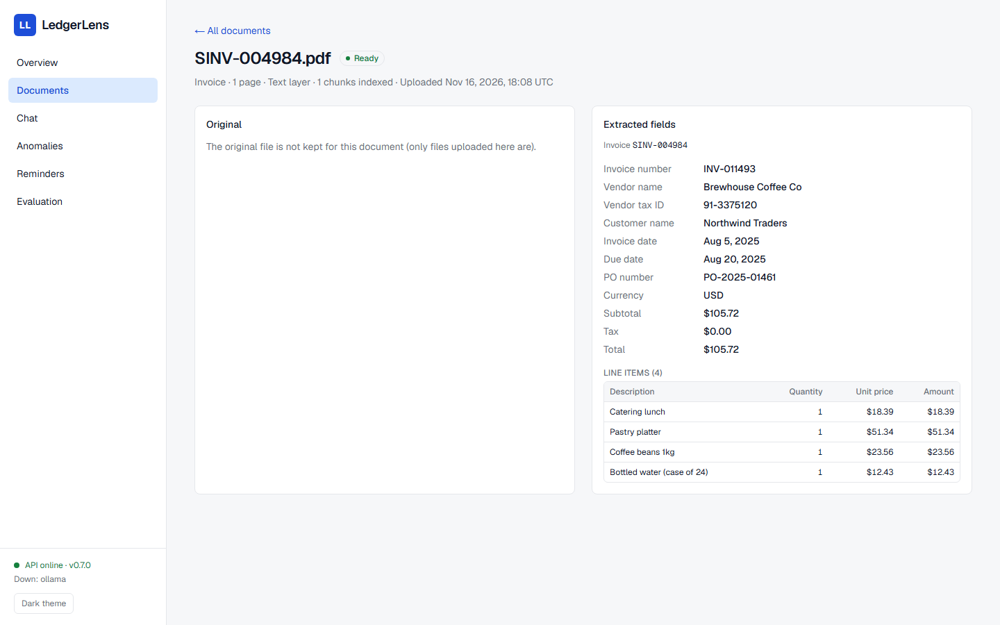
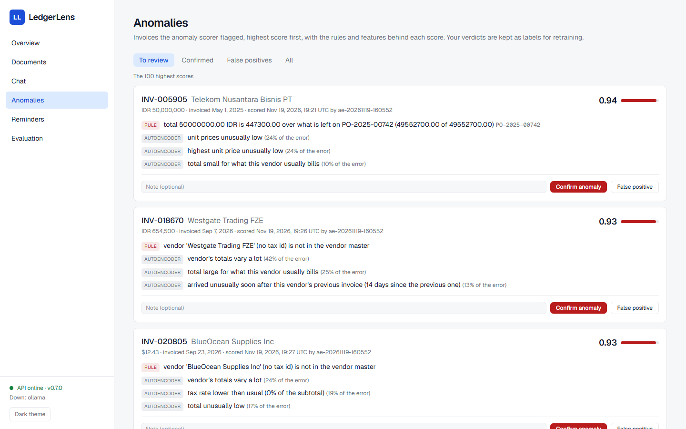
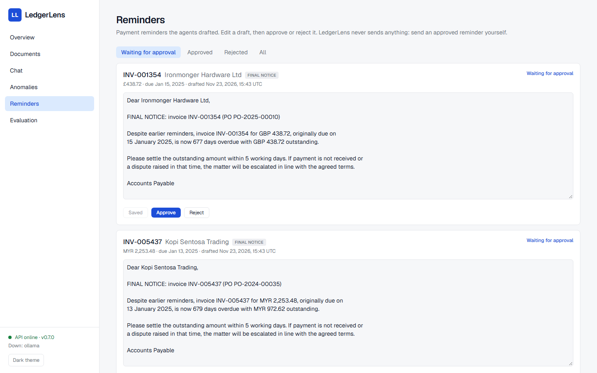
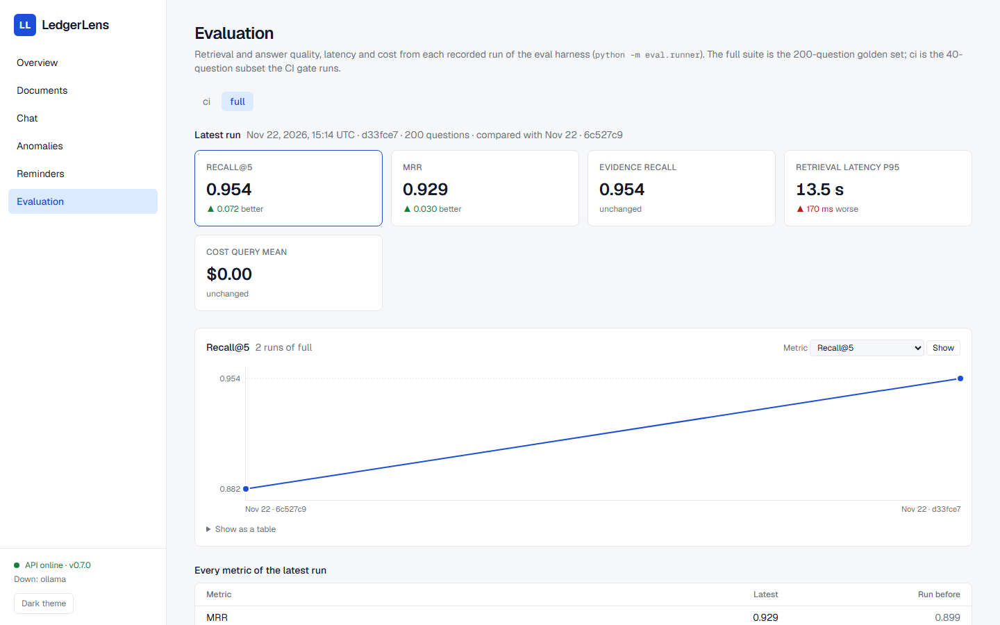

# LedgerLens

[](https://github.com/Sam15b/LedgerLens/actions/workflows/ci.yml)
[](https://github.com/Sam15b/LedgerLens/actions/workflows/eval.yml)

**Agentic GraphRAG for invoices, purchase orders and contracts.**

LedgerLens reads invoices, POs, payments and contracts (PDFs and scans), links them in a
knowledge graph, answers questions about them, flags suspicious or duplicate invoices,
and drafts payment reminders.

> 🚧 Early development: Phase 0 (foundation). See the [roadmap](docs/04-implementation-roadmap.md).

## Architecture at a glance

| Layer | What it does | Tech |
|-------|--------------|------|
| Ingestion | OCR, chunking, embeddings | Tesseract / PaddleOCR, PyMuPDF, Hugging Face transformers |
| Storage | Vectors, records, relationships | **Pinecone**, PostgreSQL, Neo4j |
| Retrieval | Hybrid vector search + Cypher graph traversal | GraphRAG |
| Agents | Router → extractor / reconciler / reminder-writer | LangGraph, MCP |
| Model router | One interface over many LLMs | GPT-4o, Gemini, Llama 3 (Ollama), Mistral, AWS Bedrock |
| Fine-tuning | Field extraction model | Llama 3 8B + LoRA (PyTorch, PEFT, CUDA) |
| Synthetic data | Invoice records + degraded scans | PyTorch GAN, Stable Diffusion img2img |
| Anomaly detection | Duplicate / suspicious invoices | TensorFlow / Keras autoencoder |
| Evaluation | Faithfulness, recall@k, F1, latency, cost | RAGAS, LangSmith / Phoenix |
| Deployment | API, dashboard, CI/CD, cloud | FastAPI, Next.js, Docker, GitHub Actions, AWS / GCP |

Full design: **[docs/](docs/README.md)**

## Live demo

**Not deployed yet.** The AWS deployment is written and checked, but no environment has
been created from it, so there is no public URL. The address will be the CloudFront URL
that `terraform output url` prints, behind the dashboard's password.

The deployment is built and checked in CI:
- Terraform in [`infra/aws/`](infra/aws/README.md) (why AWS: [ADR-0002](docs/adr/0002-cloud-target.md));
- `build.yml` pushes an image per commit to main;
- `deploy-aws.yml` deploys a `v*` tag: migrations first, then a `/health` smoke test;
- `seed_demo_data.py --bundle` loads the demo ledger: 4 vendors with their contracts,
  POs, payments and invoices (paid, unpaid, and each kind of anomaly). It needs no LLM key.



Running it all the time costs about $160 a month (estimate in ADR-0002). There is a budget
alert, and services can be scaled to zero between demos.

## Screenshots

The dashboard on the local development stores: about 1,000 documents from the synthetic
ledger and public datasets (CUAD contracts, CORD receipts), scored by the anomaly model.
This is not the live demo.



| | |
|---|---|
|  |  |
| **Overview**: unpaid and overdue per currency, flags to review | **Documents**: upload, status, type |
|  |  |
| **Document**: the fields and line items extracted from it | **Anomalies**: score, the rule and feature reasons, confirm or false positive |
|  |  |
| **Reminders**: drafts to edit, approve or reject; nothing is sent | **Evaluation**: the latest run against the one before, and the trend |

Chat is not shown: answering needs an LLM key, which this environment does not have yet.
The streaming chat, its tool-call timeline and its citations are covered by the web tests
(`web/__tests__/chat.test.tsx`).

## Project structure

```text
src/ledgerlens/   runtime package (ingestion, extraction, storage, retrieval, llm, agents, mcp_server, anomaly, api)
ml/               offline training: fine-tuning, synthetic data, anomaly model
eval/             golden set, RAGAS, retrieval benchmarks, reports
configs/          YAML config (models, Pinecone, ingestion, agents, eval)
scripts/          ops scripts (datasets, index creation, rebuilds)
tests/            unit / integration / e2e
infra/            Dockerfiles, AWS + GCP IaC
web/              Next.js dashboard
docs/             architecture, roadmap, layer guides, ADRs
```

Details: [docs/03-folder-structure.md](docs/03-folder-structure.md)

## Quick start

```bash
git clone https://github.com/Sam15b/LedgerLens.git
cd LedgerLens
python -m venv .venv
source .venv/bin/activate          # Windows: .venv\Scripts\activate
pip install -r requirements.txt    # app deps (API, ingestion, storage, LLMs, agents, eval)
pip install -e . --no-deps         # make the ledgerlens package importable
cp .env.example .env               # fill in API keys

docker compose up -d --wait postgres neo4j redis pinecone-local   # the stores (make up)
uvicorn ledgerlens.api.main:app --reload
curl http://localhost:8000/health
pytest
```

Or run the whole system in docker: the stores, a one-off init job (migrations, Pinecone
index, Neo4j schema), the API, the ingestion worker, the MCP server and the dashboard:

```bash
docker compose up -d --build --wait   # make stack; dev mode: source mounted, hot reload
open http://localhost:3000            # the dashboard
docker compose -f docker-compose.yml up -d --build --wait   # the built images only
```

Set `API_KEYS` and the same key as `LEDGERLENS_API_KEY` (and `DASHBOARD_PASSWORD`) in
`.env` before exposing it; see *Exposing a demo* below. Images are in `infra/docker/`.

ML training dependencies (LoRA fine-tuning, GAN, diffusion, Keras autoencoder) are in
`requirements-ml.txt` and are meant for a CUDA GPU on Google Colab or Kaggle:

```bash
pip install -r requirements-ml.txt
```

## Development

```bash
make setup          # .venv + app/dev deps + editable install + git hooks
make help           # list every target
```

| Target | What it does |
|--------|--------------|
| `make up` / `make down` | Start / stop local services (Docker) |
| `make api` | FastAPI with reload on `:8000` |
| `make test` | Unit tests |
| `make cov` | Unit tests with a coverage report |
| `make lint` | `ruff check`, `ruff format --check`, `mypy --strict` (src + tests) |
| `make format` | Auto-format and auto-fix lint issues |
| `make clean` | Remove caches and build artifacts |

Targets for later phases (`init`, `data`, `ingest`, `mcp`, `web`, `test-int`, `eval`, `eval-ci`)
already exist and print `not implemented yet` until their phase lands.

On Windows, install GNU make with `choco install make` (or run the commands from Git Bash);
the Makefile picks `.venv/Scripts/python.exe` automatically.

### Pre-commit hooks

`make setup` installs them; otherwise run `pre-commit install` once per clone.
Every commit then runs ruff (lint + format), mypy `--strict`, YAML/TOML checks, a
large-file guard and a private-key detector. Run them on the whole repo with:

```bash
pre-commit run --all-files
```

CI (`.github/workflows/ci.yml`) runs the same lint, format, type and test checks on every
push and pull request.

### Configuration

Secrets and per-environment values come from `.env` (see `.env.example`). Tunable values —
model aliases, chunk sizes, thresholds — live in `configs/*.yaml` and are validated at load
time (`ledgerlens.core.config.get_config()`); unknown keys are rejected.

### Exposing a demo: access, budget and abuse

Every chat run and every uploaded document can call paid LLM APIs, so a public demo
needs its spending limited on purpose. What is in place:

| Protection | Setting | Default |
|------------|---------|---------|
| API key on every route but `/health`, `/ready` and `/livez` (401 without one) | `API_KEYS` (comma-separated, so keys can be rotated with overlap) | off when empty |
| Dashboard login: a signed 12-hour session cookie; the browser never sees the API key | `DASHBOARD_PASSWORD`, `DASHBOARD_SESSION_SECRET`, `LEDGERLENS_API_KEY` (web) | off when empty |
| Chat runs per user, sliding window (429 + `Retry-After`) | `CHAT_RATE_LIMIT` | `20/minute` |
| Request deadline (504) / chat run deadline (`error` event) | `REQUEST_TIMEOUT_S` / `CHAT_TIMEOUT_S` | 60 s / 180 s |
| Upload size and type (413 / 415) | `loader.max_file_mb`, `allowed_mime_types` in `configs/ingestion.yaml` | 25 MB; PDF, PNG, JPEG, TIFF |
| Agent steps per run | `max_steps` in `configs/agents.yaml` | 8 |
| Reminders are drafts only: nothing is ever sent | none | always |

Rough worst case, from the prices in `configs/models.yaml` (an estimate, not a
measurement): a `smart` call (gpt-4o, about 4k tokens in and 500 out) costs about
$0.015. A run of 8 such steps costs about $0.12, so one user at the default limit could
spend up to about $2.40 a minute. Before exposing the demo:

- set a hard monthly spending cap with each LLM provider, which is the only limit that
  holds whatever happens here;
- lower `CHAT_RATE_LIMIT` (for example `5/minute`), or point the `smart` alias at a
  cheaper model;
- run with `LLM_COST_DB=true` so the overview's cost-per-day chart shows real spend;
- remember the rate limit is counted per API process: with several processes, add a
  shared limit at the load balancer;
- `/docs` and `/openapi.json` stay readable without a key (they describe the API, not
  its data); put them behind the proxy too if that matters.

## Datasets

[SROIE](https://rrc.cvc.uab.es/?ch=13), [CORD](https://github.com/clovaai/cord),
[FUNSD](https://guillaumejaume.github.io/FUNSD/), [CUAD](https://www.atticusprojectai.org/cuad),
plus synthetic linked invoice/PO/payment data.

## Results

Measured numbers only: each one links to the report it comes from. "Not measured" means
the run that would produce it has not happened yet, and the row says why.

| Metric | Target | Measured | Source |
|--------|--------|----------|--------|
| Faithfulness (RAGAS) | ≥ 0.85 | not measured: no working LLM key for answers and the judge yet | [`eval/run_ragas.py`](eval/run_ragas.py) |
| Retrieval recall@5 (200 questions, R4 GraphRAG) | ≥ 0.90 | **0.954** (MRR 0.929) | [summary.md](eval/reports/2026-11-22/summary.md) |
| Extraction F1 (SROIE) | ≥ 0.90 | not measured on SROIE (not downloaded). The rules baseline scores micro-F1 0.601 on a 130-document held-out set (CORD + synthetic); the fine-tuned model has not been evaluated | [finetune.md](eval/reports/2026-11-18/finetune.md) |
| Anomaly PR-AUC (held-out test split) | ≥ 0.85 | **0.830** (rules + autoencoder; rules alone 0.661) | [anomaly.md](eval/reports/2026-11-20/anomaly.md) |
| p95 query latency | < 4 s | retrieval alone: **13.5 s** p95, 6.3 s p50 (CPU cross-encoder rerank); answer step not measured | [latency_cost.md](eval/reports/2026-11-22/latency_cost.md) |
| Cost per document | < $0.01 | not measured: the dev documents were ingested with the rules extractor ($0, no LLM calls) | [latency_cost.md](eval/reports/2026-11-22/latency_cost.md) |

Retrieval recall@5 by question category, same run: lookup 0.980, clause 0.971,
multi-hop 1.000, reconciliation 1.000, aggregation 0.793. Before R4 anchored questions
on the documents they name, multi-hop was 0.833, reconciliation 0.725 and overall 0.882
([summary_before_fix.md](eval/reports/2026-11-22/summary_before_fix.md)). Every run
records its git SHA and config hash; `make eval` reproduces it on the local stores, and
pull requests that touch retrieval or the agents are gated on the 40-question CI subset
([09-evaluation.md](docs/layers/09-evaluation.md)).

### Supporting measurements

What each layer adds, from the earlier reports. These runs use different question sets
and data than the headline table, so compare numbers within a row, not across rows.

| What | Measured | Source |
|------|----------|--------|
| Retrieval variants, recall@5 (golden set v0, 47 answerable questions) | dense **0.649** → hybrid (+BM25) **0.777** → + cross-encoder rerank **0.868** → GraphRAG **0.889**. Multi-hop questions: 0.375 → 0.708 → 0.875 → **0.958** | [retrieval.md](eval/reports/2026-11-18/retrieval.md) |
| OCR on degraded scans (300 pages, Tesseract) | clean: CER **0.011**, extraction F1 0.874, key fields readable on 100 % of pages. Severity 0.5: F1 0.829 (95 % of clean). Full severity: F1 0.555 | [ocr_degraded.md](eval/reports/2026-11-14/ocr_degraded.md) |
| OCR preprocessing tuning | severity 0.5: CER 0.115 → **0.064**, key fields readable 72 % → **89 %** | [ocr_degraded.md](eval/reports/2026-11-14/ocr_degraded.md) |
| Synthetic invoice records (WGAN-GP) | **0.0 %** of generated rows break a business rule; mean KS 0.169 (unconditional) / 0.150 (conditioned on vendor category) | [gan.md](eval/reports/2026-11-13/gan.md) |
| Rendered synthetic documents (950 PDFs) | all 950 ingested; document-type accuracy 91.3 %. Rules-extractor micro-F1: payments 0.991, POs 0.990, contracts 0.895, invoices 0.724 | [extraction_synthetic.md](eval/reports/2026-11-13/extraction_synthetic.md) |
| Hybrid weight and rerank depth tuning | dense weight 0.7 (flat at 0.4–0.7); 50 rerank candidates: recall@5 0.836 → 0.868, p95 3.6 s → 7.3 s on CPU | [tuning_alpha.md](eval/reports/2026-11-18/tuning_alpha.md), [tuning_rerank_graph.md](eval/reports/2026-11-18/tuning_rerank_graph.md) |
