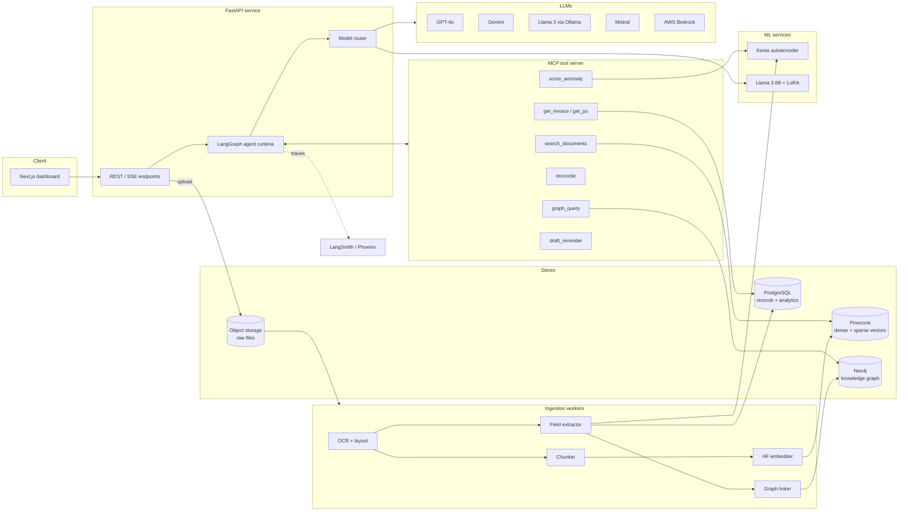
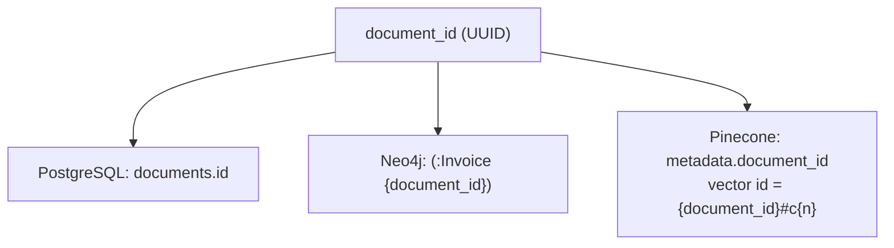

# 02 · Architecture

## High-level system diagram

## Components

| Component | Responsibility | Tech |
|-----------|---------------|------|
| **Web dashboard** | Upload docs, chat, review flags, approve reminders | Next.js (App Router), TypeScript, Tailwind |
| **API** | Auth, uploads, chat endpoint (SSE streaming), CRUD | FastAPI, Pydantic v2 |
| **Agent runtime** | Router → specialist agents with shared state | LangGraph |
| **MCP server** | Exposes data/ML capabilities as tools to any MCP client | Python `mcp` SDK (FastMCP) |
| **Model router** | One `LLMClient` interface over 5 providers + fallback, cost logging | Custom adapters (optionally LiteLLM underneath) |
| **Ingestion workers** | OCR, chunking, embedding, extraction, linking | PyMuPDF, Tesseract/PaddleOCR, sentence-transformers |
| **Pinecone** | Chunk embeddings, hybrid (dense + sparse) search, metadata filters | Pinecone serverless |
| **PostgreSQL** | Source of truth for documents, fields, line items, payments, eval runs | Postgres 16, SQLAlchemy, Alembic |
| **Neo4j** | Relationships between vendors, invoices, POs, payments, contracts | Neo4j 5, Cypher |
| **Anomaly service** | Reconstruction-error scoring + rule checks | TensorFlow/Keras |
| **Fine-tuned extractor** | Field extraction from OCR text | Llama 3 8B + LoRA (PEFT), served via Ollama/vLLM |
| **Observability** | Traces, latency, token cost | LangSmith or Arize Phoenix, OpenTelemetry |

## How the three stores relate

Every artifact has one **stable ID** that is shared across stores — this is what makes GraphRAG work.

| Store | Holds | Query style |
|-------|-------|-------------|
| Pinecone | Chunk vectors + light metadata (`document_id`, `doc_type`, `vendor_id`, `date`, `page`) | "Find text semantically like X, filtered by vendor/date" |
| Neo4j | Entities + relationships | "Which invoices reference PO-1042 and have no Payment?" |
| PostgreSQL | Full records, chunk text, line items, audit/eval tables | "Sum unpaid totals by vendor by month" |

**Rule:** PostgreSQL is the **system of record**. Pinecone and Neo4j are *derived indexes*
that can be rebuilt from Postgres + object storage (`scripts/reindex_pinecone.py`,
`scripts/rebuild_graph.py`).

## Tech stack summary

| Area | Choice |
|------|--------|
| Language | Python 3.11+ (backend/ML), TypeScript (web) |
| Package mgmt | `uv` (Python), `pnpm` (web) |
| Embeddings | `BAAI/bge-base-en-v1.5` (768-d) via sentence-transformers; BM25/SPLADE sparse vectors |
| Vector DB | **Pinecone** serverless, `dotproduct` metric (needed for hybrid) |
| Graph DB | Neo4j 5 (local Docker → AuraDB in cloud) |
| Relational | PostgreSQL 16 (local Docker → RDS / Cloud SQL) |
| Agents | LangGraph + `langchain-mcp-adapters` |
| Tool protocol | MCP (Model Context Protocol) |
| Deep learning | PyTorch + PEFT (LoRA), TensorFlow/Keras, Hugging Face `diffusers` |
| Eval / tracing | RAGAS, LangSmith or Phoenix |
| Packaging | Docker, Docker Compose |
| CI/CD | GitHub Actions |
| Cloud | AWS (ECS Fargate + Bedrock) **or** GCP (Cloud Run + Gemini) |

## Key design principles

1. **Postgres is the source of truth**; vector and graph stores are rebuildable projections.
2. **Every tool is an MCP tool** — agents never call databases directly.
3. **Every LLM call goes through the model router** — enables cost tracking, fallback, A/B.
4. **Idempotent ingestion** — re-ingesting a file (same SHA-256) is a no-op.
5. **Human-in-the-loop** for anything outward-facing (sending reminders).
6. **Evaluation is a first-class pipeline**, run in CI on every PR touching retrieval/agents.
