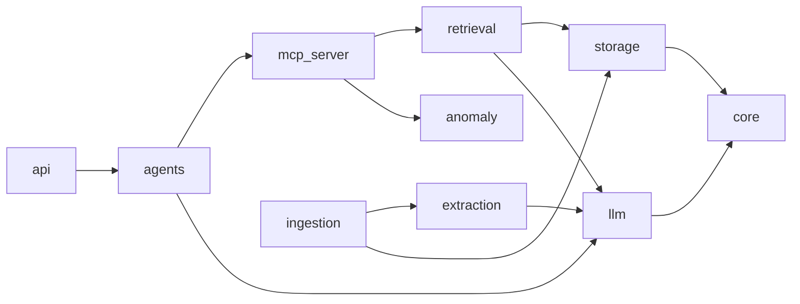

# 03 · Folder Structure

A monorepo: one Python package (`src/ledgerlens`) for all runtime code, separate
top-level folders for offline ML training, evaluation, the web app and infrastructure.

```text
LedgerLens/
├── README.md
├── pyproject.toml                 # uv project: deps, ruff, mypy, pytest config
├── uv.lock
├── Makefile                       # make setup | up | ingest | eval | test | lint
├── .env.example                   # every env var, documented (no secrets)
├── .pre-commit-config.yaml
├── docker-compose.yml             # api, worker, mcp, web, postgres, neo4j, redis, pinecone-local, ollama
├── docker-compose.override.yml    # dev-only: hot reload, mounted volumes
│
├── .github/
│   └── workflows/
│       ├── ci.yml                 # lint, type-check, unit + integration tests
│       ├── eval.yml               # golden-set eval on PRs touching retrieval/agents
│       ├── build.yml              # build & push Docker images
│       ├── deploy-aws.yml         # ECS Fargate + Bedrock
│       └── deploy-gcp.yml         # Cloud Run + Gemini
│
├── docs/                          # ← you are here
│   ├── README.md
│   ├── 01-project-overview.md … 06-dev-workflow.md
│   ├── layers/                    # one guide per system layer
│   └── adr/                       # architecture decision records
│
├── configs/
│   ├── models.yaml                # model router: providers, model ids, prices, fallbacks
│   ├── pinecone.yaml              # index name, dimension, metric, namespaces
│   ├── ingestion.yaml             # OCR engine, chunk sizes per doc type
│   ├── agents.yaml                # which model each agent uses, max steps
│   └── eval.yaml                  # metrics, thresholds, golden-set path
│
├── data/                          # git-ignored (except .gitkeep + README)
│   ├── raw/                       # sroie/, cord/, funsd/, cuad/
│   ├── interim/                   # OCR output, page images
│   ├── processed/                 # normalized JSONL (one record per document)
│   ├── synthetic/                 # GAN records, rendered PDFs, degraded scans
│   └── golden/                    # golden_set.jsonl (≈200 Qs) — this one IS committed
│
├── src/
│   └── ledgerlens/
│       ├── __init__.py
│       ├── core/
│       │   ├── config.py          # pydantic-settings; loads .env + configs/*.yaml
│       │   ├── logging.py
│       │   ├── ids.py             # document_id, vector-id helpers
│       │   └── schemas/           # Pydantic domain models
│       │       ├── document.py
│       │       ├── invoice.py     # Invoice, LineItem
│       │       ├── purchase_order.py
│       │       ├── payment.py
│       │       └── contract.py
│       │
│       ├── ingestion/
│       │   ├── loaders.py         # PDF/image loading, SHA-256 dedupe
│       │   ├── ocr/
│       │   │   ├── base.py        # OCREngine protocol
│       │   │   ├── tesseract.py
│       │   │   └── paddle.py
│       │   ├── layout.py          # text-layer detection, table regions
│       │   ├── chunking.py        # doc-type-aware chunkers
│       │   ├── embedding.py       # HF dense + sparse encoders
│       │   └── pipeline.py        # orchestrates load→ocr→chunk→embed→extract→store
│       │
│       ├── extraction/
│       │   ├── base.py            # Extractor protocol → typed schema
│       │   ├── rules.py           # regex/heuristic baseline
│       │   ├── llm_extractor.py   # prompt + JSON-schema via model router
│       │   ├── finetuned.py       # Llama 3 8B + LoRA adapter
│       │   └── normalize.py       # dates, currency, vendor-name canonicalization
│       │
│       ├── storage/
│       │   ├── pinecone_store.py  # upsert/query/delete, hybrid search
│       │   ├── postgres/
│       │   │   ├── db.py          # engine/session
│       │   │   ├── models.py      # SQLAlchemy ORM tables
│       │   │   ├── repositories.py
│       │   │   └── analytics.sql  # saved analytic queries (aging, spend by vendor)
│       │   └── neo4j/
│       │       ├── driver.py
│       │       ├── schema.cypher  # constraints + indexes
│       │       ├── linker.py      # builds nodes/edges from extracted records
│       │       └── queries.py     # parameterized Cypher templates
│       │
│       ├── retrieval/
│       │   ├── vector.py          # Pinecone-only retriever (baseline)
│       │   ├── graph.py           # Cypher expansion around seed documents
│       │   ├── text2cypher.py     # LLM → Cypher with schema + guardrails
│       │   ├── graphrag.py        # vector seeds + graph expansion + fusion
│       │   ├── rerank.py          # cross-encoder reranker
│       │   └── context.py         # context assembly + citations
│       │
│       ├── llm/
│       │   ├── router.py          # LLMClient: complete(), structured(), stream()
│       │   ├── types.py           # Message, LLMResponse, Usage
│       │   ├── pricing.py         # token → $ cost
│       │   └── providers/
│       │       ├── openai_provider.py     # GPT-4o
│       │       ├── gemini_provider.py
│       │       ├── ollama_provider.py     # Llama 3 + fine-tuned adapter
│       │       ├── mistral_provider.py
│       │       └── bedrock_provider.py
│       │
│       ├── agents/
│       │   ├── state.py           # LedgerState TypedDict
│       │   ├── graph.py           # LangGraph StateGraph wiring
│       │   ├── nodes/
│       │   │   ├── router.py      # intent classification + hand-off
│       │   │   ├── qa.py          # GraphRAG answerer
│       │   │   ├── extractor.py
│       │   │   ├── reconciler.py  # 3-way match
│       │   │   └── reminder_writer.py
│       │   ├── prompts/           # *.md prompt templates, versioned
│       │   └── tools.py           # loads MCP tools for LangGraph
│       │
│       ├── mcp_server/
│       │   ├── server.py          # FastMCP app
│       │   └── tools/
│       │       ├── search.py      # search_documents
│       │       ├── graph.py       # graph_query, get_vendor_ledger
│       │       ├── records.py     # get_invoice, get_po, list_overdue
│       │       ├── reconcile.py
│       │       ├── anomaly.py     # score_anomaly
│       │       └── reminders.py   # draft_reminder (never sends)
│       │
│       ├── anomaly/
│       │   ├── features.py        # feature engineering for invoices
│       │   ├── rules.py           # exact/near duplicate, round-amount, etc.
│       │   └── scorer.py          # loads Keras model, returns score + reasons
│       │
│       ├── api/
│       │   ├── main.py            # FastAPI app factory
│       │   ├── deps.py
│       │   └── routers/
│       │       ├── documents.py   # upload, list, get
│       │       ├── chat.py        # SSE streaming agent endpoint
│       │       ├── anomalies.py
│       │       ├── reminders.py   # list drafts, approve/reject
│       │       └── health.py
│       │
│       ├── workers/
│       │   └── ingest_worker.py   # background queue consumer (arq / Celery / RQ)
│       │
│       └── observability/
│           ├── tracing.py         # LangSmith / Phoenix setup
│           └── cost.py            # per-request + per-document cost ledger
│
├── ml/                            # offline training — not imported by the API
│   ├── finetune/
│   │   ├── prepare_dataset.py     # SROIE/CORD → instruction JSONL
│   │   ├── train_lora.py          # PyTorch + PEFT (QLoRA) training
│   │   ├── merge_and_export.py    # merge adapter → GGUF for Ollama
│   │   ├── eval_extraction.py
│   │   └── notebooks/
│   │       └── colab_qlora_llama3.ipynb
│   ├── synthetic/
│   │   ├── gan/
│   │   │   ├── dataset.py
│   │   │   ├── model.py           # tabular GAN (generator + discriminator)
│   │   │   ├── train.py
│   │   │   └── sample.py
│   │   ├── render/
│   │   │   └── render_documents.py  # records → PDF invoices/POs (Jinja + WeasyPrint)
│   │   └── diffusion/
│   │       └── degrade_scans.py   # Stable Diffusion img2img degraded variants
│   └── anomaly/
│       ├── build_features.py
│       ├── train_autoencoder.py   # TensorFlow/Keras
│       └── evaluate.py
│
├── eval/
│   ├── golden_set/
│   │   ├── build_golden_set.py    # helper to draft + review questions
│   │   └── schema.md              # question categories + fields
│   ├── run_ragas.py               # faithfulness, answer relevancy, context recall
│   ├── benchmark_retrieval.py     # vector RAG vs hybrid vs GraphRAG, recall@k
│   ├── extraction_f1.py
│   ├── latency_cost.py            # p95 latency, $/doc
│   └── reports/                   # dated markdown/JSON results (committed)
│
├── web/                           # Next.js dashboard
│   ├── package.json
│   ├── app/
│   │   ├── page.tsx               # overview KPIs
│   │   ├── documents/             # upload + list + viewer
│   │   ├── chat/                  # agent chat with citations
│   │   ├── anomalies/             # flagged invoices review
│   │   └── reminders/             # draft approval queue
│   ├── components/
│   └── lib/api.ts                 # typed client for FastAPI
│
├── infra/
│   ├── docker/
│   │   ├── api.Dockerfile
│   │   ├── worker.Dockerfile
│   │   ├── mcp.Dockerfile
│   │   └── web.Dockerfile
│   ├── aws/                       # Terraform (or CDK): ECS, RDS, ECR, Secrets, IAM for Bedrock
│   └── gcp/                       # Terraform: Cloud Run, Cloud SQL, Artifact Registry, Secret Manager
│
├── scripts/
│   ├── download_datasets.py
│   ├── create_pinecone_index.py
│   ├── init_neo4j_schema.py
│   ├── seed_demo_data.py
│   ├── reindex_pinecone.py        # rebuild vectors from Postgres
│   └── rebuild_graph.py           # rebuild Neo4j from Postgres
│
└── tests/
    ├── conftest.py
    ├── fixtures/                  # tiny sample PDFs, expected JSON
    ├── unit/                      # mirrors src/ledgerlens/
    ├── integration/               # needs docker compose services
    └── e2e/                       # upload → ask → answer with citation
```

## Placement rules

| If you are writing… | Put it in… |
|---------------------|-----------|
| Code the API or workers import at runtime | `src/ledgerlens/<layer>/` |
| A training script or notebook | `ml/<track>/` |
| Something that measures quality | `eval/` |
| A one-off or ops command | `scripts/` |
| Tunable values (model names, chunk sizes, thresholds) | `configs/*.yaml` — never hard-coded |
| Secrets | `.env` locally, cloud secret manager in prod — never committed |
| A prompt | `src/ledgerlens/agents/prompts/*.md` |
| A design decision | `docs/adr/NNNN-title.md` |

## Dependency direction



Lower layers (`core`, `storage`, `llm`) must never import higher layers (`agents`, `api`).
