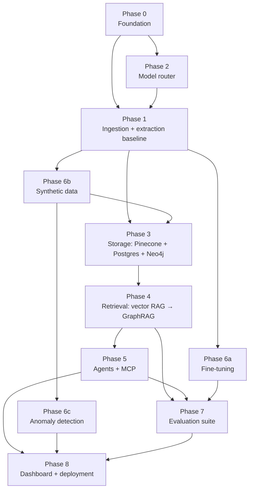
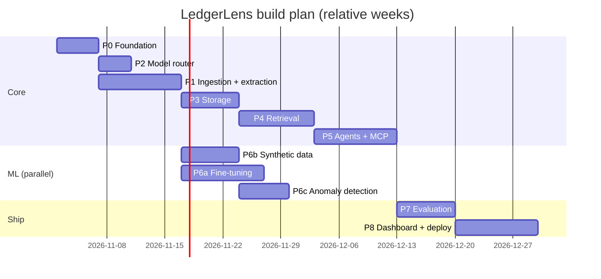

# 04 · Implementation Roadmap

Build order is chosen so that **every phase ends with something runnable and measurable**,
and later phases plug into interfaces defined earlier. Estimated at ~12 weeks part-time;
ML tracks (Phase 6) can run in parallel once Phase 1 data exists.

## Phase dependency graph

## Timeline

---

## Phase 0 — Foundation (week 1)

**Goal:** empty-but-working skeleton; all services start with one command.

- [ ] `git init`, `.gitignore` (data/, .env, model weights), branch protection on `main`
- [ ] `pyproject.toml` with `uv`; ruff, mypy, pytest, pre-commit
- [ ] Create the folder tree from [03-folder-structure.md](03-folder-structure.md)
- [ ] `core/config.py` (pydantic-settings) + `.env.example`
- [ ] `docker-compose.yml`: postgres, neo4j, pinecone-local, ollama, api (FastAPI `/health`)
- [ ] Create a Pinecone account + API key; `scripts/create_pinecone_index.py`
- [ ] `.github/workflows/ci.yml`: lint + type-check + unit tests
- [ ] `scripts/download_datasets.py` for SROIE, CORD, FUNSD (+ CUAD)

**Exit criteria:** `make up && curl localhost:8000/health` → `{"status":"ok"}` with all
dependencies reported healthy; CI green.

## Phase 1 — Ingestion + extraction baseline (weeks 2–3) · [guide](layers/01-ingestion.md)

- [ ] Loader with SHA-256 dedupe; text-layer detection (PyMuPDF) → skip OCR when text exists
- [ ] OCR engine interface + Tesseract implementation (PaddleOCR optional)
- [ ] Doc-type-aware chunker (invoice = header + line-items chunks; contract = clause chunks)
- [ ] Dense embedder (`bge-base-en-v1.5`) + sparse encoder (BM25)
- [ ] Extraction: regex baseline → LLM extractor with JSON schema (via model router)
- [ ] Normalizers: dates, currency, vendor-name canonicalization
- [ ] `ingestion/pipeline.py` CLI: `python -m ledgerlens.ingestion.pipeline data/raw/sroie`

**Exit criteria:** SROIE test split processed end-to-end; baseline extraction F1 recorded in
`eval/reports/` (this is the number fine-tuning must beat).

## Phase 2 — Model router (week 2, parallel) · [guide](layers/05-model-router.md)

- [ ] `LLMClient` interface: `complete`, `structured` (Pydantic output), `stream`
- [ ] Providers: OpenAI (GPT-4o), Ollama (Llama 3) first; then Gemini, Mistral, Bedrock
- [ ] `configs/models.yaml` with model aliases (`fast`, `smart`, `local`, `extractor`)
- [ ] Fallback chain + retries; usage + cost logging per call

**Exit criteria:** same prompt runs against all 5 providers via a single call with
`model="alias"`; cost recorded per call.

## Phase 3 — Storage (week 4) · [guide](layers/02-storage.md)

- [ ] Postgres schema + Alembic migrations (documents, chunks, vendors, invoices, line_items, purchase_orders, payments, contracts)
- [ ] `pinecone_store.py`: batched upsert, hybrid query, metadata filters, delete-by-document
- [ ] Neo4j constraints + `linker.py` (Vendor → Invoice → PO → Payment, Contract → PO)
- [ ] Ingestion pipeline writes to all three stores in one idempotent step
- [ ] Rebuild scripts: `reindex_pinecone.py`, `rebuild_graph.py`
- [ ] SQL analytics: AP aging, spend by vendor, unpaid totals

**Exit criteria:** ingesting the synthetic set produces matching counts in Postgres,
Pinecone (`describe_index_stats`) and Neo4j; integration tests pass.

## Phase 4 — Retrieval (weeks 5–6) · [guide](layers/03-retrieval.md)

- [ ] **Baseline:** Pinecone dense-only RAG
- [ ] Hybrid (dense + sparse) + cross-encoder rerank
- [ ] Graph expansion: seed documents → Cypher neighborhood
- [ ] Text2Cypher for aggregation / multi-hop questions (read-only, validated)
- [ ] `graphrag.py` fuses vector + graph context with citations
- [ ] Golden set v0 (~50 Qs) → `benchmark_retrieval.py`

**Exit criteria:** benchmark table (vector vs hybrid vs GraphRAG) on golden set v0 committed.

## Phase 5 — Agents + MCP (weeks 7–8) · [guide](layers/04-agents-mcp.md)

- [ ] MCP server with tools: `search_documents`, `graph_query`, `get_invoice`, `list_overdue`, `reconcile`, `score_anomaly`, `draft_reminder`
- [ ] LangGraph `StateGraph`: router → {qa, extractor, reconciler, reminder_writer}
- [ ] Reconciler: 3-way match with tolerances; mismatch report
- [ ] Reminder writer: tone by days overdue; `interrupt()` for human approval
- [ ] `/chat` SSE endpoint streaming tokens + tool events

**Exit criteria:** the 5 user stories in [01-project-overview](01-project-overview.md) work
via API; MCP server also works from an external MCP client (e.g. Claude Desktop / MCP Inspector).

## Phase 6 — ML tracks (weeks 5–10, parallel)

| Track | Guide | Exit criteria |
|-------|-------|---------------|
| 6a Fine-tuning Llama 3 8B (QLoRA) | [layers/06](layers/06-fine-tuning.md) | Adapter beats Phase-1 baseline F1; served via Ollama and selectable in router |
| 6b Synthetic data (GAN + SD img2img) | [layers/07](layers/07-synthetic-data.md) | 5k linked synthetic records; degraded-scan set with OCR CER measured clean vs degraded |
| 6c Anomaly autoencoder (Keras) | [layers/08](layers/08-anomaly-detection.md) | PR-AUC on injected anomalies reported; `score_anomaly` tool live |

## Phase 7 — Evaluation suite (week 10–11) · [guide](layers/09-evaluation.md)

- [ ] Golden set expanded to ~200 Qs across categories
- [ ] RAGAS: faithfulness, answer relevancy, context precision/recall
- [ ] recall@k, extraction F1, p95 latency, cost per document
- [ ] LangSmith or Phoenix tracing wired to every agent run
- [ ] `eval.yml` GitHub Action with regression thresholds

**Exit criteria:** `make eval` produces a dated report; CI fails if faithfulness or recall drop
beyond threshold.

## Phase 8 — Dashboard + deployment (weeks 11–12) · [guide](layers/10-deployment.md)

- [ ] Next.js pages: overview KPIs, documents, chat (with citations), anomalies, reminders queue
- [ ] Dockerfiles + full `docker compose up`
- [ ] Deploy path A: AWS (ECS Fargate + RDS + Bedrock) **or** path B: GCP (Cloud Run + Cloud SQL + Gemini)
- [ ] GitHub Actions: build → push → deploy on tag
- [ ] README with architecture diagram, demo GIF, measured metrics table

**Exit criteria:** public demo URL; README metrics filled from `eval/reports/`.

---

## Milestone checklist (portfolio-ready)

| Milestone | Proof |
|-----------|-------|
| M1 Ingest | `make ingest` on SROIE; extraction F1 baseline |
| M2 GraphRAG | Benchmark table: vector vs GraphRAG |
| M3 Agents | Recorded demo of router hand-offs + MCP tool calls |
| M4 ML | Fine-tune F1 delta, GAN samples, degraded-scan OCR CER, anomaly PR-AUC |
| M5 Eval | RAGAS report + p95 latency + $/doc |
| M6 Ship | Live URL, CI badges, resume bullet numbers |
