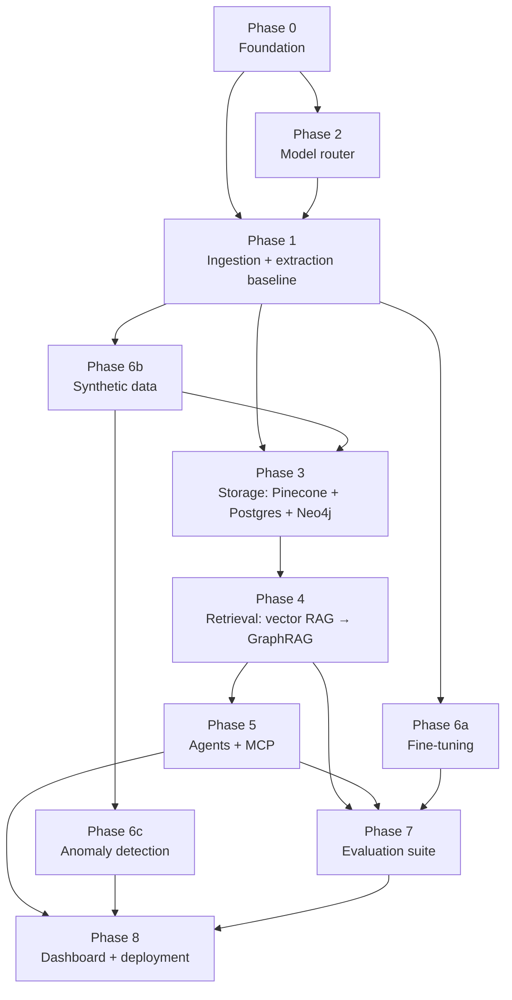
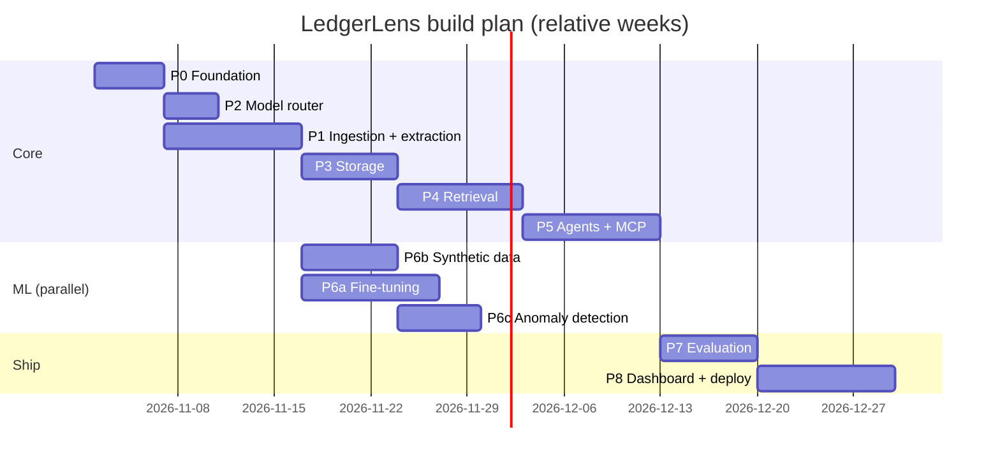

# 04 · Implementation Roadmap

Build order is chosen so that **every phase ends with something runnable and measurable**,
and later phases plug into interfaces defined earlier. Estimated at ~12 weeks part-time;
ML tracks (Phase 6) can run in parallel once Phase 1 data exists.

## Phase dependency graph

## Timeline

---

## Phase 0 — Foundation (week 1)

**Goal:** empty-but-working skeleton; all services start with one command.

- [x] `git init`, `.gitignore` (data/, .env, model weights)
- [ ] Branch protection on `main` (GitHub repository settings): not set; every change
  still goes through a PR with CI
- [x] `pyproject.toml`; ruff, mypy (`--strict`), pytest, pre-commit — dependencies are managed
  with pip + `requirements.txt` rather than `uv`
- [x] Create the folder tree from [03-folder-structure.md](03-folder-structure.md)
- [x] `core/config.py` (pydantic-settings + validated `configs/*.yaml`) + `.env.example`
- [x] `docker-compose.yml`: postgres, neo4j, redis, pinecone-local, ollama with healthchecks;
  the API runs via `make api` (its container arrives with the Dockerfiles in Phase 8)
- [x] FastAPI `/health` (per-dependency status) and `/ready`
- [x] `scripts/create_pinecone_index.py` (idempotent; cloud or Pinecone Local)
  and `scripts/init_neo4j_schema.py`
- [ ] Create a Pinecone account + API key (only needed for the cloud index)
- [x] `.github/workflows/ci.yml`: lint + format + type-check + unit tests, plus an
  integration job against the compose services
- [x] `scripts/download_datasets.py` for SROIE (manual instructions), CORD, FUNSD and CUAD

**Exit criteria:** `make up && curl localhost:8000/health` → `{"status":"ok"}` with all
dependencies reported healthy; CI green.

**Status:** met — with the compose stack up, `/health` reports Postgres, Neo4j, Redis and
Pinecone (Local) as `ok` and `/ready` returns 200; unit and integration CI jobs run on every PR.

## Phase 1 — Ingestion + extraction baseline (weeks 2–3) · [guide](layers/01-ingestion.md)

- [x] Loader with SHA-256 dedupe; text-layer detection (PyMuPDF) → skip OCR when text exists
- [x] OCR engine interface + Tesseract implementation (PaddleOCR optional)
- [x] Doc-type-aware chunker (invoice = header + line-items chunks; contract = clause chunks)
- [x] Dense embedder (`bge-base-en-v1.5`) + sparse encoder (BM25)
- [x] Extraction: regex baseline → LLM extractor with JSON schema (via model router)
- [x] Normalizers: dates, currency, vendor-name canonicalization
- [x] `ingestion/pipeline.py` CLI: `python -m ledgerlens.ingestion.pipeline data/raw/sroie`

**Exit criteria:** SROIE test split processed end-to-end; baseline extraction F1 recorded in
`eval/reports/` (this is the number fine-tuning must beat).

**Status:** partly met. SROIE was not downloaded (it needs a manual registration). The
baseline is recorded on CORD and rendered synthetic documents instead: rules micro-F1
0.601 on a 130-document held-out set ([finetune.md](../eval/reports/2026-11-18/finetune.md)),
and per-type F1 on 950 synthetic PDFs
([extraction_synthetic.md](../eval/reports/2026-11-13/extraction_synthetic.md)).

## Phase 2 — Model router (week 2, parallel) · [guide](layers/05-model-router.md)

- [x] `LLMClient` interface: `complete`, `structured` (Pydantic output), `stream`
- [x] Providers: OpenAI (GPT-4o), Ollama (Llama 3) first; then Gemini, Mistral, Bedrock
- [x] `configs/models.yaml` with model aliases (`fast`, `smart`, `local`, `extractor`)
- [x] Fallback chain + retries; usage + cost logging per call

**Exit criteria:** same prompt runs against all 5 providers via a single call with
`model="alias"`; cost recorded per call.

**Status:** built, and tested against each provider's request format.
`scripts/llm_smoke.py` is the live check across providers. It is still waiting for working
API keys: the OpenAI key on the development machine is rejected (401).

## Phase 3 — Storage (week 4) · [guide](layers/02-storage.md)

- [x] Postgres schema + Alembic migrations (documents, chunks, vendors, invoices, line_items, purchase_orders, payments, contracts)
- [x] `pinecone_store.py`: batched upsert, hybrid query, metadata filters, delete-by-document
- [x] Neo4j constraints + `linker.py` (Vendor → Invoice → PO → Payment, Contract → PO)
- [x] Ingestion pipeline writes to all three stores in one idempotent step
- [x] Rebuild scripts: `reindex_pinecone.py`, `rebuild_graph.py`
- [x] SQL analytics: AP aging, spend by vendor, unpaid totals

**Exit criteria:** ingesting the synthetic set produces matching counts in Postgres,
Pinecone (`describe_index_stats`) and Neo4j; integration tests pass.

**Status:** met. The loaders end with a store parity check
([storage.md](../eval/reports/2026-11-16/storage.md)), and CI runs the integration tests.

## Phase 4 — Retrieval (weeks 5–6) · [guide](layers/03-retrieval.md)

- [x] **Baseline:** Pinecone dense-only RAG
- [x] Hybrid (dense + sparse) + cross-encoder rerank
- [x] Graph expansion: seed documents → Cypher neighborhood
- [x] Text2Cypher for aggregation / multi-hop questions (read-only, validated)
- [x] `graphrag.py` fuses vector + graph context with citations
- [x] Golden set v0 (~50 Qs) → `benchmark_retrieval.py`

**Exit criteria:** benchmark table (vector vs hybrid vs GraphRAG) on golden set v0 committed.

**Status:** met. recall@5: dense 0.649, hybrid 0.777, + rerank 0.868, GraphRAG 0.889
([retrieval.md](../eval/reports/2026-11-18/retrieval.md)).

## Phase 5 — Agents + MCP (weeks 7–8) · [guide](layers/04-agents-mcp.md)

- [x] MCP server with tools: `search_documents`, `graph_query`, `get_invoice`, `list_overdue`, `reconcile`, `score_anomaly`, `draft_reminder`
- [x] LangGraph `StateGraph`: router → {qa, extractor, reconciler, reminder_writer}
- [x] Reconciler: 3-way match with tolerances; mismatch report
- [x] Reminder writer: tone by days overdue; `interrupt()` for human approval
- [x] `/chat` SSE endpoint streaming tokens + tool events

**Exit criteria:** the 5 user stories in [01-project-overview](01-project-overview.md) work
via API; MCP server also works from an external MCP client (e.g. Claude Desktop / MCP Inspector).

**Status:** the five stories run end to end through the API in
`tests/e2e/test_stories.py`. They use the agents' model-free paths: the rules router, the
evidence answer and the rules extractor. Running them with a model needs an LLM key.

## Phase 6 — ML tracks (weeks 5–10, parallel)

| Track | Guide | Exit criteria |
|-------|-------|---------------|
| 6a Fine-tuning Llama 3 8B (QLoRA) | [layers/06](layers/06-fine-tuning.md) | Adapter beats Phase-1 baseline F1; served via Ollama and selectable in router |
| 6b Synthetic data (GAN + SD img2img) | [layers/07](layers/07-synthetic-data.md) | 5k linked synthetic records; degraded-scan set with OCR CER measured clean vs degraded |
| 6c Anomaly autoencoder (Keras) | [layers/08](layers/08-anomaly-detection.md) | PR-AUC on injected anomalies reported; `score_anomaly` tool live |

**Status:**
- **6a:** not met. The dataset, the QLoRA training code, the merge and export, and the
  Ollama Modelfile are built. Training needs a GPU and none has been available, so there
  is no adapter and no F1 delta yet.
- **6b:** partly met. The GAN, the 5k linked records, and the rendered and degraded scans
  are done, with OCR CER measured clean vs degraded
  ([ocr_degraded.md](../eval/reports/2026-11-14/ocr_degraded.md)). The Stable Diffusion
  img2img variants were not generated (they also need a GPU).
- **6c:** met. PR-AUC is 0.830 on the held-out test split
  ([anomaly.md](../eval/reports/2026-11-20/anomaly.md)), and `score_anomaly` is an MCP tool.

## Phase 7 — Evaluation suite (week 10–11) · [guide](layers/09-evaluation.md)

- [x] Golden set expanded to ~200 Qs across categories
- [x] RAGAS: faithfulness, answer relevancy, context precision/recall (scores need an LLM key)
- [x] recall@k, extraction F1, p95 latency, cost per document
- [x] LangSmith or Phoenix tracing wired to every agent run
- [x] `eval.yml` GitHub Action with regression thresholds (live once the eval-store secrets exist)

**Exit criteria:** `make eval` produces a dated report; CI fails if faithfulness or recall drop
beyond threshold.

## Phase 8 — Dashboard + deployment (weeks 11–12) · [guide](layers/10-deployment.md)

- [x] Next.js pages: overview KPIs, documents, chat (with citations), anomalies, reminders
  queue, evaluation
- [x] Dockerfiles + full `docker compose up`
- [x] Deploy path A: AWS (ECS Fargate + RDS + Bedrock) **or** path B: GCP (Cloud Run +
  Cloud SQL + Gemini): AWS, as Terraform ([ADR-0002](adr/0002-cloud-target.md)); not yet
  applied to an account
- [x] GitHub Actions: build → push → deploy on tag
- [x] README with architecture diagram, demo GIF, measured metrics table

**Exit criteria:** public demo URL; README metrics filled from `eval/reports/`.

**Status:** partly met. The README metrics come from `eval/reports/`. There is no public
URL yet: the deployment is written and checked in CI (`terraform test`, actionlint), but
no AWS account has been set up for it.

---

## Milestone checklist (portfolio-ready)

| Milestone | Proof | Status |
|-----------|-------|--------|
| M1 Ingest | `make ingest` on SROIE; extraction F1 baseline | baseline on CORD + synthetic; SROIE not downloaded |
| M2 GraphRAG | Benchmark table: vector vs GraphRAG | done |
| M3 Agents | Recorded demo of router hand-offs + MCP tool calls | end-to-end story tests; a recording needs an LLM key |
| M4 ML | Fine-tune F1 delta, GAN samples, degraded-scan OCR CER, anomaly PR-AUC | all but the fine-tune delta (no GPU) |
| M5 Eval | RAGAS report + p95 latency + $/doc | recall and retrieval latency; RAGAS and $/doc need an LLM key |
| M6 Ship | Live URL, CI badges, resume bullet numbers | CI badges and measured numbers; the live URL needs an AWS account |
