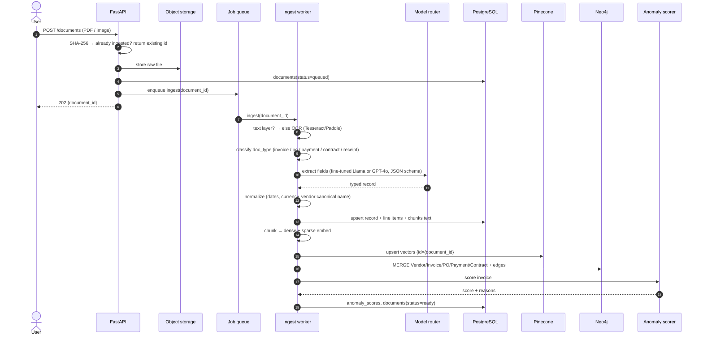
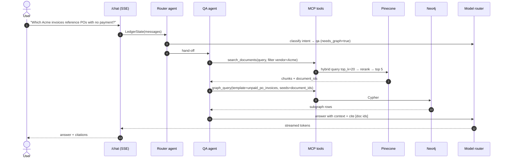
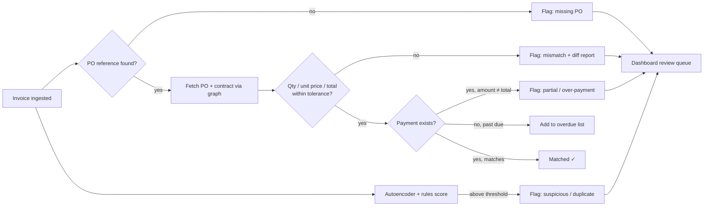

# 05 · Data & Request Flows

Four end-to-end flows cover everything the system does.

## Flow 1 — Document ingestion



**Failure handling:** each step writes `documents.status` + `error`; re-running is safe
because Postgres uses upserts, Pinecone upserts overwrite by id, and Neo4j uses `MERGE`.

## Flow 2 — Question answering (GraphRAG)



**Routing inside QA:**

| Question shape | Retrieval strategy |
|----------------|--------------------|
| Lookup in text ("payment terms in the Acme contract?") | Hybrid vector search → rerank |
| Relationship / multi-hop ("invoices whose PO has no payment") | Vector seeds → Cypher template expansion |
| Aggregate ("total unpaid by vendor in Q3") | Text2Cypher or SQL analytics tool |

## Flow 3 — Reconciliation & anomaly review



## Flow 4 — Payment reminder (human-in-the-loop)

```mermaid
sequenceDiagram
    autonumber
    actor C as Collections user
    participant R as Router agent
    participant RW as Reminder writer
    participant MCP as MCP tools
    participant MR as Model router
    participant PG as PostgreSQL

    C->>R: "Draft reminders for invoices 30+ days overdue"
    R->>RW: hand-off
    RW->>MCP: list_overdue(min_days=30)
    MCP-->>RW: invoices + vendor contacts + history
    loop each invoice
        RW->>MR: draft (tone by days overdue, cite invoice/PO numbers)
        RW->>MCP: draft_reminder(save as status=pending_approval)
    end
    RW-->>C: interrupt() — review drafts
    C->>PG: approve / edit / reject (dashboard)
    Note over PG: v1 marks approved; sending is stubbed
```

## Data lifecycle

| Stage | Location | Retention |
|-------|----------|-----------|
| Raw upload | Object storage (`raw/{document_id}`) | Keep |
| OCR text + page images | `data/interim` (local) / object storage | Regenerable |
| Structured record | PostgreSQL | Source of truth |
| Chunk vectors | Pinecone namespace | Rebuildable from Postgres |
| Graph | Neo4j | Rebuildable from Postgres |
| Traces | LangSmith / Phoenix | 30–90 days |
