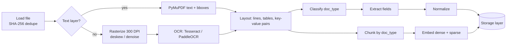

# Layer 1 · Ingestion

**Code:** `src/ledgerlens/ingestion/`, `src/ledgerlens/extraction/` · **Phase:** 1

## Purpose
Turn PDFs and scanned images into clean text, typed records, chunks and embeddings.

## Inputs → Outputs

| Input | Output |
|-------|--------|
| PDF (digital or scanned), PNG/JPG | `ExtractedDocument` (typed fields), `Chunk[]` with dense + sparse vectors |

## Pipeline



## Components

| Module | Responsibility |
|--------|----------------|
| `loaders.py` | Read file, compute SHA-256, page count, MIME; reject unsupported types |
| `layout.py` | Detect text layer; group words into lines/blocks; detect table regions |
| `ocr/base.py` | `OCREngine` protocol: `run(image) -> list[OCRWord(text, bbox, conf)]` |
| `ocr/tesseract.py` | `pytesseract` with `--psm 6`; returns words + confidences |
| `ocr/paddle.py` | PaddleOCR alternative (better on noisy receipts) |
| `chunking.py` | Doc-type-aware chunking (below) |
| `embedding.py` | Dense: sentence-transformers `bge-base-en-v1.5`; sparse: BM25 encoder fit on corpus |
| `extraction/*` | rules → LLM → fine-tuned extractors, all returning the same Pydantic schema |
| `pipeline.py` | Orchestrates the steps; records status and timings per step |

## Chunking strategy

| doc_type | Strategy | Size |
|----------|----------|------|
| Invoice / receipt | 1 **header chunk** (vendor, dates, totals, PO ref) + 1 **line-items chunk** (table rendered as markdown) | Small; whole doc usually ≤ 2 chunks |
| Purchase order | Same as invoice | — |
| Contract | Split on clause headings (`1.`, `Section`, `ARTICLE`), then recursive split | ~400–512 tokens, 50-token overlap |
| Payment advice | Single chunk | — |

Each chunk is prefixed with a short context header, e.g.
`[INVOICE INV-889 | Vendor: Acme Corp | Date: 2026-03-14]`, which noticeably improves retrieval
for short, number-heavy documents.

## Extraction schema (simplified)

```python
class LineItem(BaseModel):
    description: str
    quantity: Decimal | None
    unit_price: Decimal | None
    amount: Decimal

class Invoice(BaseModel):
    invoice_number: str
    vendor_name: str
    vendor_tax_id: str | None
    invoice_date: date
    due_date: date | None
    po_number: str | None
    currency: str = "USD"
    subtotal: Decimal | None
    tax: Decimal | None
    total: Decimal
    line_items: list[LineItem] = []
```

Extractor progression (each is measured with `eval/extraction_f1.py`):
1. `rules.py` — regex for totals, dates, invoice numbers (baseline).
2. `llm_extractor.py` — GPT-4o / Gemini with JSON-schema structured output.
3. `finetuned.py` — Llama 3 8B + LoRA ([layer 6](06-fine-tuning.md)); cheap + local.

## Implementation steps

1. Implement `loaders.py` + SHA-256 dedupe; unit test with fixtures.
2. Implement text-layer detection; route digital PDFs past OCR.
3. Implement `TesseractEngine`; measure CER on a SROIE sample.
4. Implement chunkers per doc type with golden fixture tests.
5. Implement dense embedder (batch size 32, normalize embeddings) and fit BM25 on the corpus; persist the BM25 params to `data/processed/bm25.json`.
6. Implement rule extractor → LLM extractor; run F1 eval; record baseline.
7. Wire `pipeline.py` and a CLI; emit per-step timings for latency metrics.

## Config (`configs/ingestion.yaml`)

```yaml
ocr:
  engine: tesseract        # tesseract | paddle
  dpi: 300
  min_confidence: 40
chunking:
  contract: { max_tokens: 512, overlap: 50 }
embedding:
  dense_model: BAAI/bge-base-en-v1.5
  batch_size: 32
  sparse: bm25
extraction:
  default: llm             # rules | llm | finetuned
  model_alias: extractor
```

## Tests
- Unit: dedupe, text-layer detection, chunk boundaries, normalizers (dates like `14/03/26`, `$1,234.50`).
- Integration: ingest 5 fixture PDFs → expected JSON.

## Definition of done
- SROIE test split ingested with per-document status `ready`.
- Extraction F1 baseline written to `eval/reports/`.
- Median ingest time per document recorded.
