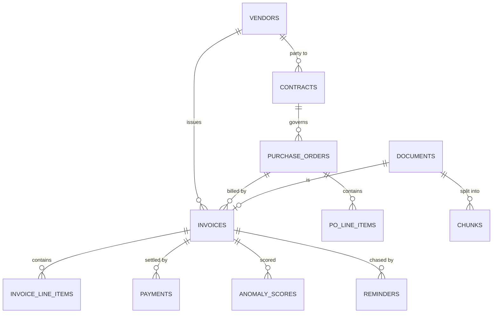
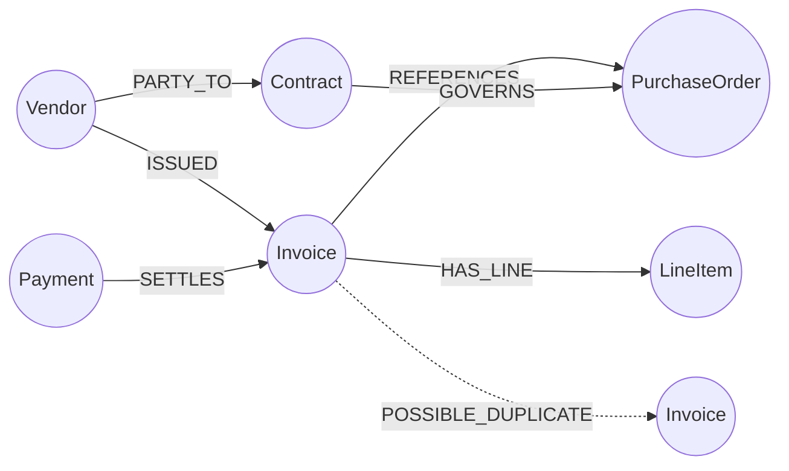

# Layer 2 · Storage (Pinecone + PostgreSQL + Neo4j)

**Code:** `src/ledgerlens/storage/` · **Phase:** 3 · **ADR:** [0001](../adr/0001-pinecone-for-vector-store.md)

## Purpose
Persist each document three ways — as **vectors** (Pinecone), **records** (PostgreSQL) and
**relationships** (Neo4j) — all keyed by the same `document_id`.

---

## Pinecone (vector store)

### Index design

| Setting | Value | Why |
|---------|-------|-----|
| Index name | `ledgerlens-chunks` | One index for all chunk types |
| Type | Serverless | No capacity planning; pay per use |
| Dimension | 768 | `bge-base-en-v1.5` |
| Metric | `dotproduct` | Required for hybrid dense + sparse queries |
| Namespaces | `dev`, `eval`, `prod` (later: one per tenant) | Isolation; eval runs never pollute prod |
| Cloud / region | Same as app (`aws/us-east-1` or `gcp/us-central1`) | Latency |

### Vector record

```json
{
  "id": "3f2c…-uuid#c0",
  "values": [0.012, …],
  "sparse_values": {"indices": [102, 4096], "values": [0.41, 0.22]},
  "metadata": {
    "document_id": "3f2c…-uuid",
    "doc_type": "invoice",
    "vendor_id": "v_acme",
    "doc_number": "INV-889",
    "doc_date": 20260314,
    "page": 1,
    "chunk_index": 0,
    "text": "[INVOICE INV-889 | Vendor: Acme] … (truncated ~1 KB)"
  }
}
```

- Dates stored as `YYYYMMDD` integers so `$gte` / `$lte` range filters work.
- Keep metadata small; **full chunk text lives in Postgres** (`chunks` table), fetched by id.
- Vector id pattern `{document_id}#c{n}` enables delete-by-prefix on re-ingest.

### `pinecone_store.py` interface

```python
class PineconeStore:
    def upsert_chunks(self, chunks: list[EmbeddedChunk], namespace: str) -> None: ...   # batches of 100
    def query(self, dense: list[float], sparse: SparseVector | None,
              top_k: int, filter: dict | None, namespace: str,
              alpha: float = 0.7) -> list[VectorHit]: ...                                # alpha-weighted hybrid
    def delete_document(self, document_id: str, namespace: str) -> None: ...
    def stats(self) -> dict: ...
```

Hybrid weighting: scale dense values by `alpha` and sparse values by `1 - alpha` before
querying; tune `alpha` on the golden set.

### Local development
Use the **Pinecone Local** Docker emulator in `docker-compose.yml` for tests and CI
(set `PINECONE_HOST`); use the real serverless index for eval runs and production.
Check Pinecone's docs for the current image name and ports.

---

## PostgreSQL (system of record + analytics)

### Core tables



| Table | Key columns |
|-------|-------------|
| `documents` | id, sha256, filename, doc_type, status, error, pages, ocr_engine, created_at |
| `chunks` | id (= Pinecone id), document_id, chunk_index, text, token_count |
| `vendors` | id, canonical_name, aliases[], tax_id, email |
| `invoices` | id, document_id, vendor_id, invoice_number, invoice_date, due_date, po_number, currency, subtotal, tax, total, status |
| `purchase_orders` | id, document_id, vendor_id, po_number, contract_id, total |
| `payments` | id, invoice_id, amount, paid_at, method, reference |
| `contracts` | id, document_id, vendor_id, start_date, end_date, payment_terms_days, rate_card JSONB |
| `anomaly_scores` | invoice_id, model_version, score, reasons JSONB |
| `reminders` | id, invoice_id, draft, tone, status (pending_approval/approved/rejected) |
| `llm_calls` | id, request_id, provider, model, tokens_in, tokens_out, cost_usd, latency_ms |
| `eval_runs` | id, git_sha, config JSONB, metrics JSONB, created_at |

Migrations via **Alembic**. Example analytics (`analytics.sql`): AP aging buckets
(0–30/31–60/61–90/90+), spend by vendor by month, unpaid totals, average days-to-pay.

---

## Neo4j (knowledge graph)

### Graph model



Every node carries `document_id` (if from a document) so graph results map back to
Pinecone chunks and Postgres rows.

### Schema (`schema.cypher`)

```cypher
CREATE CONSTRAINT vendor_id   IF NOT EXISTS FOR (v:Vendor)        REQUIRE v.id IS UNIQUE;
CREATE CONSTRAINT invoice_id  IF NOT EXISTS FOR (i:Invoice)       REQUIRE i.id IS UNIQUE;
CREATE CONSTRAINT po_id       IF NOT EXISTS FOR (p:PurchaseOrder) REQUIRE p.id IS UNIQUE;
CREATE CONSTRAINT payment_id  IF NOT EXISTS FOR (p:Payment)       REQUIRE p.id IS UNIQUE;
CREATE CONSTRAINT contract_id IF NOT EXISTS FOR (c:Contract)      REQUIRE c.id IS UNIQUE;
CREATE INDEX invoice_number IF NOT EXISTS FOR (i:Invoice) ON (i.invoice_number);
CREATE INDEX po_number      IF NOT EXISTS FOR (p:PurchaseOrder) ON (p.po_number);
```

### Linking (`linker.py`)

```cypher
MERGE (v:Vendor {id: $vendor_id}) SET v.name = $vendor_name
MERGE (i:Invoice {id: $invoice_id})
  SET i += {invoice_number: $invoice_number, total: $total,
            invoice_date: date($invoice_date), due_date: date($due_date),
            document_id: $document_id}
MERGE (v)-[:ISSUED]->(i)
WITH i
OPTIONAL MATCH (p:PurchaseOrder {po_number: $po_number})
FOREACH (_ IN CASE WHEN p IS NULL THEN [] ELSE [1] END | MERGE (i)-[:REFERENCES]->(p))
```

Linking keys: PO number on invoice → `PurchaseOrder.po_number`; payment reference →
invoice number; vendor resolved via canonical name / tax id (fuzzy match with `rapidfuzz`
on aliases). Unresolved links are recorded so the reconciler can flag them.

## Write path (idempotent)

1. Postgres transaction: upsert document, record, line items, chunks.
2. Pinecone: `delete_document` then `upsert_chunks`.
3. Neo4j: `MERGE` nodes + edges.
4. Mark `documents.status = ready`. Any failure → `status = failed` + error; safe to retry.

## Definition of done
- Counts match across stores for the synthetic dataset.
- `reindex_pinecone.py` and `rebuild_graph.py` rebuild from Postgres alone.
- Analytics queries return expected numbers on fixtures.
