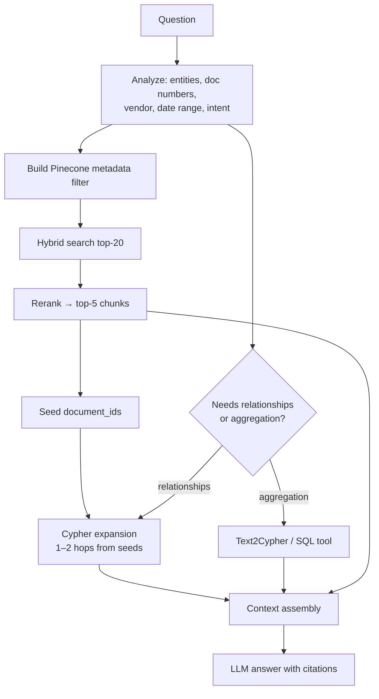

# Layer 3 · Retrieval (Vector RAG → GraphRAG)

**Code:** `src/ledgerlens/retrieval/` · **Phase:** 4

## Purpose
Return the best evidence for a question by combining Pinecone vector search with
Neo4j graph traversal — and **prove** it beats plain vector RAG.

## Retriever variants (all benchmarked)

| ID | Variant | How |
|----|---------|-----|
| R1 | Dense vector RAG (baseline) | Pinecone dense query top-k |
| R2 | Hybrid | Pinecone dense + sparse (alpha-weighted) |
| R3 | Hybrid + rerank | R2 top-20 → cross-encoder (`BAAI/bge-reranker-base`) → top-5 |
| R4 | **GraphRAG** | R3 seeds → Cypher neighborhood expansion → fused context |
| R5 | GraphRAG + Text2Cypher | R4, plus LLM-generated Cypher for aggregation / multi-hop |

## GraphRAG algorithm



### Cypher expansion templates (`queries.py`)

```cypher
// invoice_neighborhood: everything linked to seed invoices
MATCH (i:Invoice) WHERE i.document_id IN $seed_ids
OPTIONAL MATCH (v:Vendor)-[:ISSUED]->(i)
OPTIONAL MATCH (i)-[:REFERENCES]->(po:PurchaseOrder)
OPTIONAL MATCH (c:Contract)-[:GOVERNS]->(po)
OPTIONAL MATCH (pay:Payment)-[:SETTLES]->(i)
RETURN i, v, po, c, collect(pay) AS payments;

// unpaid_with_po: multi-hop question template
MATCH (v:Vendor {id: $vendor_id})-[:ISSUED]->(i:Invoice)-[:REFERENCES]->(po:PurchaseOrder)
WHERE NOT ( ()-[:SETTLES]->(i) )
RETURN i.invoice_number, i.total, i.due_date, po.po_number
ORDER BY i.due_date;
```

Prefer **parameterized templates** for common question shapes; fall back to Text2Cypher only
when no template matches.

### Text2Cypher guardrails
- Prompt includes the graph schema (labels, relationship types, properties) + few-shot examples.
- Reject any query containing write clauses (`CREATE`, `MERGE`, `SET`, `DELETE`, `REMOVE`, `CALL dbms`), run with a **read-only** Neo4j user / `READ` access mode.
- `EXPLAIN` before execution; enforce `LIMIT`; timeout 5 s.
- On error, retry once with the error message, then fall back to R3.

## Context assembly (`context.py`)
- Graph rows are rendered as compact facts: `Invoice INV-889 (Acme, $4,200, due 2026-04-13) → PO-1042 → no payment`.
- Each fact/chunk gets a citation tag `[doc:INV-889]` mapped to `document_id`.
- Token budget: chunks 60 %, graph facts 40 %; dedupe by `document_id`.

## Interfaces

```python
class Retriever(Protocol):
    def retrieve(self, query: str, *, filters: QueryFilters | None = None,
                 k: int = 5) -> RetrievalResult: ...

class RetrievalResult(BaseModel):
    chunks: list[ScoredChunk]
    graph_facts: list[GraphFact]
    citations: dict[str, str]        # tag -> document_id
    timings_ms: dict[str, float]
```

All variants implement `Retriever` so `benchmark_retrieval.py` can swap them.

## Benchmark design

| Question category | Example | Expected winner |
|-------------------|---------|-----------------|
| Single-doc lookup | "What's the total on INV-889?" | All similar |
| Clause lookup | "Late-payment penalty in the Acme contract?" | R3 |
| Multi-hop | "Acme invoices whose PO has no payment?" | R4 |
| Aggregation | "Total unpaid by vendor for Q1?" | R5 / SQL |
| Cross-document consistency | "Does INV-889's unit price match the contract rate?" | R4 |

Metrics per variant and category: recall@k, MRR, RAGAS context precision/recall,
answer correctness, p95 latency, cost per query. Results → `eval/reports/<date>/retrieval.md`.

## Definition of done
- All five variants implement `Retriever`.
- Benchmark table committed, broken down by question category.
- Default retriever chosen in `configs/` based on measured results.
