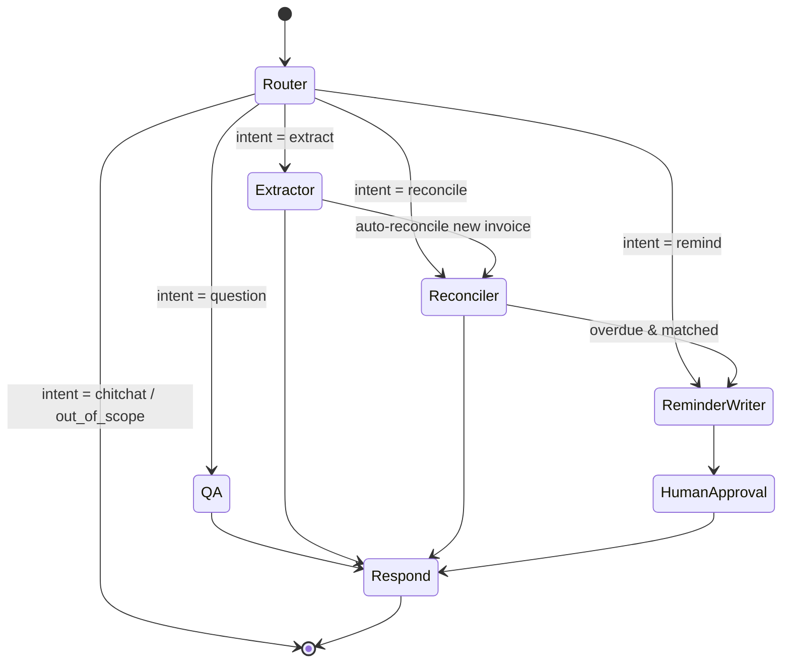

# Layer 4 · Agents (LangGraph) + Tools (MCP)

**Code:** `src/ledgerlens/agents/`, `src/ledgerlens/mcp_server/` · **Phase:** 5

## Purpose
A **router agent** understands the user's request and hands off to specialist agents
(QA, extractor, reconciler, reminder writer). All data access happens through tools
exposed by an **MCP server**, so the same tools work from LangGraph, Claude Desktop,
or any MCP client.

## Agent graph



## Shared state (`state.py`)

```python
class LedgerState(TypedDict):
    messages: Annotated[list[AnyMessage], add_messages]
    intent: Literal["question", "extract", "reconcile", "remind", "other"] | None
    document_ids: list[str]
    extracted: dict | None              # Invoice/PO record
    reconciliation: dict | None         # match result + diffs
    reminder_drafts: list[dict]
    citations: dict[str, str]
    step_count: int
    errors: list[str]
```

## Agents

| Node | Model alias | Tools used | Output |
|------|-------------|------------|--------|
| **Router** | `fast` (e.g. GPT-4o-mini / Gemini Flash / Llama 3) | none — structured output | `intent`, extracted entities |
| **QA** | `smart` | `search_documents`, `graph_query`, `run_analytics` | Answer + citations |
| **Extractor** | `extractor` (fine-tuned Llama 3) | `get_document_text`, `save_extraction` | Typed record |
| **Reconciler** | `smart` | `get_invoice`, `get_po`, `get_contract`, `get_payments`, `reconcile` | Match / mismatch report |
| **Reminder writer** | `smart` | `list_overdue`, `get_vendor_contact`, `draft_reminder` | Drafts pending approval |

### Reconciler logic (deterministic core, LLM explains)
The 3-way match is **code**, not LLM judgment — the LLM only narrates results.

| Check | Rule (configurable tolerance) |
|-------|-------------------------------|
| PO exists | invoice.po_number resolves in graph |
| Vendor match | invoice.vendor_id == po.vendor_id |
| Line qty | Σ invoiced qty ≤ PO qty |
| Unit price | \|invoice − contract rate\| ≤ 2 % |
| Total | \|invoice.total − Σ lines − tax\| ≤ 0.01 |
| Payment | Σ payments vs total → paid / partial / over / unpaid |
| Terms | due_date consistent with contract `payment_terms_days` |

### Reminder writer
- Tone by days overdue: 1–15 friendly · 16–45 firm · 46+ final notice.
- Must cite invoice number, amount, original due date, PO number.
- Uses LangGraph `interrupt()` → drafts stored as `pending_approval`; resumes on approve/reject.
- **Never sends** in v1.

### Guardrails
- `step_count` limit (e.g. 8) to prevent loops.
- Tool errors are returned to the agent as messages, not raised.
- Every answer must have ≥1 citation or explicitly say evidence wasn't found.

## MCP server

Built with the Python MCP SDK (`FastMCP`). Runs over **stdio** (local clients) or
**streamable HTTP** (container in compose).

| Tool | Args | Returns |
|------|------|---------|
| `search_documents` | `query, doc_type?, vendor?, date_from?, date_to?, k=5` | chunks + document_ids |
| `graph_query` | `template, params` or `question` (Text2Cypher) | rows |
| `run_analytics` | `report` (aging / spend_by_vendor / unpaid) + params | table |
| `get_invoice` / `get_po` / `get_contract` | `id or number` | record |
| `get_payments` | `invoice_id` | payments |
| `list_overdue` | `min_days, vendor?` | invoices |
| `reconcile` | `invoice_id` | match report |
| `score_anomaly` | `invoice_id` | score + reasons |
| `draft_reminder` | `invoice_id, body, tone` | reminder id (status pending) |

```python
# mcp_server/tools/search.py (sketch)
@mcp.tool()
def search_documents(query: str, doc_type: str | None = None,
                     vendor: str | None = None, k: int = 5) -> list[dict]:
    """Semantic + keyword search over invoices, POs and contracts."""
    return retriever.retrieve(query, filters=QueryFilters(doc_type=doc_type, vendor=vendor), k=k).to_tool_output()
```

LangGraph loads the tools via `langchain-mcp-adapters` (`MultiServerMCPClient`), and each
agent node is bound only to the tools it needs.

## API integration
- `POST /chat` → runs the graph, streams via **SSE**: `token`, `tool_call`, `tool_result`, `citation`, `interrupt`, `done` events.
- `POST /reminders/{id}/approve|reject` → resumes the interrupted graph (checkpointer: Postgres).

## Tests
- Router intent accuracy on a labeled set of ~100 utterances.
- Reconciler unit tests over synthetic cases (each mismatch type).
- Agent trajectory tests: expected tool-call sequence for each user story.

## Definition of done
- All user stories pass end-to-end via `/chat`.
- MCP server usable from MCP Inspector / an external MCP client.
- Traces show router → specialist hand-offs and tool calls.
