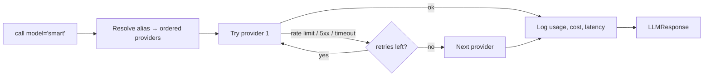

# Layer 5 · Model Router

**Code:** `src/ledgerlens/llm/` · **Phase:** 2

## Purpose
One interface for every LLM: **GPT-4o, Gemini, Llama 3 (Ollama), Mistral, AWS Bedrock**
(plus the fine-tuned Llama 3 adapter). Callers ask for an **alias**, not a vendor.

## Interface

```python
class LLMClient:
    def complete(self, messages: list[Message], *, model: str = "smart",
                 temperature: float = 0.0, max_tokens: int | None = None) -> LLMResponse: ...
    def structured(self, messages: list[Message], schema: type[T], *, model: str = "smart") -> T: ...
    def stream(self, messages: list[Message], *, model: str = "smart") -> Iterator[str]: ...

class LLMProvider(Protocol):
    name: str
    def complete(self, req: LLMRequest) -> LLMResponse: ...
    def stream(self, req: LLMRequest) -> Iterator[str]: ...

class LLMResponse(BaseModel):
    text: str
    provider: str
    model: str
    usage: Usage            # tokens_in, tokens_out
    cost_usd: float
    latency_ms: float
```

## Providers

| Provider | SDK | Notes |
|----------|-----|-------|
| OpenAI (GPT-4o) | `openai` | Native JSON-schema structured outputs |
| Gemini | `google-genai` (or Vertex AI on GCP) | `response_schema` for structured output |
| Ollama (Llama 3, fine-tuned) | HTTP / `ollama` | `format=json` / JSON schema; local, $0 |
| Mistral | `mistralai` | JSON mode |
| AWS Bedrock | `boto3` `bedrock-runtime` **Converse API** | One API for Llama, Mistral, Anthropic, etc. on Bedrock |

Provider-specific message formats are converted inside each adapter; the rest of the code
only sees `Message` / `LLMResponse`. (LiteLLM can be used under the adapters to save work,
but keep the `LLMClient` interface yours.)

## Configuration (`configs/models.yaml`)

```yaml
aliases:
  fast:      [gemini/gemini-flash, openai/gpt-4o-mini, ollama/llama3:8b]   # fallback order
  smart:     [openai/gpt-4o, bedrock/<model-id>, gemini/gemini-pro]
  local:     [ollama/llama3:8b]
  extractor: [ollama/ledgerlens-llama3-lora, openai/gpt-4o-mini]
  judge:     [openai/gpt-4o]                                              # eval only

pricing_usd_per_1m_tokens:      # fill from provider pricing pages; review regularly
  openai/gpt-4o:      { in: null, out: null }   # TODO: fill from pricing page
  ollama/llama3:8b:   { in: 0.0, out: 0.0 }

retry: { max_attempts: 3, backoff_s: [1, 2, 4] }
timeout_s: 60
```

> Model IDs and prices change — keep them only in this file and check provider docs.

## Routing behaviour



- **Fallback** on transient errors only; validation errors are not retried on another provider.
- **Cost logging** to `llm_calls` table + trace span attributes.
- **Per-environment overrides**: on AWS deploy, `smart` → Bedrock; on GCP, `smart` → Gemini.

## Tests
- Contract tests: each provider adapter against recorded responses (no live calls in CI).
- Live smoke test (manual / nightly): one prompt per provider.
- Structured output: same schema across all providers parses into the Pydantic model.

## Definition of done
- `LLMClient().complete(msgs, model="local")` and `model="smart"` both work.
- All 5 providers callable; cost per call recorded.
- Comparison table (quality on extraction, latency, $) across providers in `eval/reports/`.
