# Layer 6 · Fine-tuning Llama 3 8B with LoRA

**Code:** `ml/finetune/` · **Runtime use:** `src/ledgerlens/extraction/finetuned.py` · **Phase:** 6a

## Purpose
Train a small, cheap, local model for **field extraction** (OCR text → JSON) that matches or
beats a general-purpose API model, so ingestion cost per document drops.

## Workflow

```mermaid
flowchart LR
    A[SROIE + CORD + synthetic<br/>OCR text + labels] --> B[prepare_dataset.py<br/>instruction JSONL]
    B --> C[Upload to HF Hub / Kaggle dataset<br/>private]
    C --> D[Colab / Kaggle GPU<br/>train_lora.py QLoRA]
    D --> E[LoRA adapter<br/>+ training logs]
    E --> F[eval_extraction.py<br/>F1 on held-out test]
    F -- beats baseline --> G[merge_and_export.py<br/>merge → GGUF]
    G --> H[Ollama Modelfile<br/>ledgerlens-llama3-lora]
    H --> I[Model router alias: extractor]
```



## Data format

```json
{"instruction": "Extract invoice fields as JSON matching the schema.",
 "input": "<OCR text>",
 "output": "{\"vendor_name\": \"…\", \"invoice_date\": \"2026-03-14\", \"total\": \"42.50\", …}"}
```

- Train / val / test split **by source document**, never by chunk.
- Use the official SROIE/CORD test splits as the held-out test set.
- Mix in ~20–30 % synthetic invoices (with POs, line items) so the model learns fields that receipts lack.
- Apply the Llama 3 chat template; compute loss on the response tokens only.

## Training setup (PyTorch + PEFT + bitsandbytes)

| Setting | Starting value |
|---------|----------------|
| Base | `meta-llama/Meta-Llama-3-8B-Instruct` (accept license on HF) |
| Quantization | 4-bit NF4 (QLoRA) — fits a 16 GB T4 / P100 |
| LoRA r / alpha / dropout | 16 / 32 / 0.05 |
| Target modules | `q_proj, k_proj, v_proj, o_proj, gate_proj, up_proj, down_proj` |
| Max seq length | 2048 |
| LR / schedule | 2e-4, cosine, warmup 3 % |
| Effective batch | 16 (micro-batch 2 × grad-accum 8) |
| Epochs | 2–3 |
| Precision | fp16 on T4 (no bf16), bf16 on A100/L4 |
| Gradient checkpointing | on |

Trainer: Hugging Face `transformers` + `peft` (optionally TRL `SFTTrainer`).
Save adapter checkpoints to Google Drive / Kaggle output to survive session timeouts.

## Evaluation (`eval_extraction.py`)
- **Field-level F1**: exact match after normalization (dates ISO, amounts to 2 dp, whitespace/case-folded strings).
- **JSON validity rate** (parses against the Pydantic schema).
- Latency/tokens per doc on the local GPU/CPU via Ollama.
- Compare: rules baseline · GPT-4o · Gemini · base Llama 3 8B · fine-tuned.

| Model | F1 | JSON valid % | $/1k docs | p95 latency |
|-------|----|--------------|-----------|-------------|
| Rules baseline | | | 0 | |
| GPT-4o | | | | |
| Llama 3 8B (base) | | | 0 | |
| **Llama 3 8B + LoRA** | | | 0 | |

*(Fill from `ml/finetune/runs/`.)*

## Serving
1. Merge adapter into base weights (`merge_and_export.py`).
2. Convert to GGUF with `llama.cpp` tooling, quantize (e.g. Q4_K_M).
3. `ollama create ledgerlens-llama3-lora -f Modelfile`.
4. Register under the `extractor` alias in `configs/models.yaml`.
   Alternative: serve base + adapter with vLLM's LoRA support.

## Definition of done
- Adapter + training config + metrics logged in `ml/finetune/runs/<run_id>/`.
- Fine-tuned F1 > Phase-1 baseline on the held-out test set.
- Model callable via router alias `extractor`.
