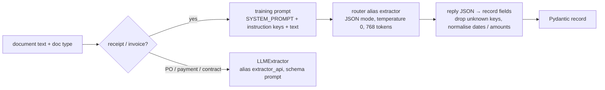

# Layer 6 · Fine-tuning Llama 3 8B with LoRA

**Code:** `ml/finetune/` · **Runtime use:** `src/ledgerlens/extraction/finetuned.py` · **Phase:** 6a

## Purpose
Train a small, cheap, local model for **field extraction** (OCR text → JSON) that matches or
beats a general-purpose API model, so ingestion cost per document drops.

## Workflow

```mermaid
flowchart LR
    A[SROIE + CORD + synthetic<br/>OCR text + labels] --> B[prepare_dataset.py<br/>instruction JSONL]
    B --> C[Upload to HF Hub / Kaggle dataset<br/>private]
    C --> D[Colab / Kaggle GPU<br/>train_lora.py QLoRA]
    D --> E[LoRA adapter<br/>+ training logs]
    E --> F[eval_extraction.py<br/>F1 on held-out test]
    F -- beats baseline --> G[merge_and_export.py<br/>merge → GGUF]
    G --> H[Ollama Modelfile<br/>ledgerlens-llama3-lora]
    H --> I[Model router alias: extractor]
```



## Data format

```json
{"instruction": "Extract invoice fields as JSON matching the schema.",
 "input": "<OCR text>",
 "output": "{\"vendor_name\": \"…\", \"invoice_date\": \"2026-03-14\", \"total\": \"42.50\", …}"}
```

- Train / val / test split **by source document**, never by chunk.
- Use the official SROIE/CORD test splits as the held-out test set.
- Mix in ~20–30 % synthetic invoices (with POs, line items) so the model learns fields that receipts lack.
- Apply the Llama 3 chat template; compute loss on the response tokens only.

## Training setup (PyTorch + PEFT + bitsandbytes)

| Setting | Starting value |
|---------|----------------|
| Base | `meta-llama/Meta-Llama-3-8B-Instruct` (accept license on HF) |
| Quantization | 4-bit NF4 (QLoRA) — fits a 16 GB T4 / P100 |
| LoRA r / alpha / dropout | 16 / 32 / 0.05 |
| Target modules | `q_proj, k_proj, v_proj, o_proj, gate_proj, up_proj, down_proj` |
| Max seq length | 2048 |
| LR / schedule | 2e-4, cosine, warmup 3 % |
| Effective batch | 16 (micro-batch 2 × grad-accum 8) |
| Epochs | 2–3 |
| Precision | fp16 on T4 (no bf16), bf16 on A100/L4 |
| Gradient checkpointing | on |

Trainer: Hugging Face `transformers` + `peft` (optionally TRL `SFTTrainer`).
Save adapter checkpoints to Google Drive / Kaggle output to survive session timeouts.

## Evaluation (`eval_extraction.py`)
- **Field-level F1**: exact match after normalization (dates ISO, amounts to 2 dp, whitespace/case-folded strings).
- **JSON validity rate** (parses against the Pydantic schema).
- Latency/tokens per doc on the local GPU/CPU via Ollama.
- Compare: rules baseline · GPT-4o · Gemini · base Llama 3 8B · fine-tuned.

| Model | F1 | JSON valid % | $/1k docs | p95 latency |
|-------|----|--------------|-----------|-------------|
| Rules baseline | 0.601 | n/a | 0 | ~0 ms |
| GPT-4o | | | | |
| Llama 3 8B (base) | | | 0 | |
| **Llama 3 8B + LoRA** | | | 0 | |

*(Filled from `python -m ml.finetune.eval_extraction --report ...`; latest:
[eval/reports/2026-11-18/finetune.md](../../eval/reports/2026-11-18/finetune.md). The
other rows need an API key, a GPU and the run-1 adapter.)*

## Serving
1. Merge the adapter into the float16 base weights and export:
   `python -m ml.finetune.merge_and_export --adapter <run>/adapter --out <export> --llama-cpp llama.cpp`.
   This runs llama.cpp's `convert_hf_to_gguf.py` (f16) and `llama-quantize` (Q4_K_M,
   ~4.9 GB), then copies `ml/finetune/Modelfile` next to the GGUF. `<export>/export.json`
   records the commands and hashes.
2. `ollama create ledgerlens-llama3-lora -f <export>/Modelfile`. The Modelfile has the
   Llama 3 chat template, the training system prompt, greedy decoding and a stop at
   `<|eot_id|>`.
3. `configs/models.yaml`: `extractor: [ollama/ledgerlens-llama3-lora, openai/gpt-4o-mini, ...]`.
4. `configs/ingestion.yaml`: `extraction.default: finetuned` once the model beats the
   rules baseline on the test split.
   Alternative: serve base + adapter with vLLM's LoRA support.

The runtime side is `ledgerlens.extraction.finetuned.FineTunedExtractor`:



- **One prompt contract.** `SYSTEM_PROMPT`, the key lists and `instruction()` live in
  `extraction/finetuned.py`, and `ml/finetune/prepare_dataset.py` imports them from there.
  The model is served the exact prompt it was trained on, and a contract test checks
  this message by message.
- **Fallback.** If Ollama is down, the router retries it, then moves on. If the model was
  never created, Ollama answers 404 and the next model is called at once. The API models
  behind it get the same prompt, which spells out the JSON to write.
- **Two aliases.** The generic `LLMExtractor` (its own prompt plus the record's JSON
  schema) uses `extractor_api`, so that prompt never reaches the fine-tuned model.
- **Not trained for.** Receipt targets have no `receipt_number` or `currency` (SROIE and
  CORD do not label them), so a receipt's currency falls back to the schema default.

## Definition of done
- Adapter + training config + metrics logged in `ml/finetune/runs/<run_id>/`.
- Fine-tuned F1 > Phase-1 baseline on the held-out test set.
- Model callable via router alias `extractor`.

Status (2026-11-19): only the third point is met. The two runs' configs and data are
pinned in `runs/run-1/` and `runs/run-2/`, but neither run has been trained (no GPU or
Llama 3 access on the dev machine), so there are no metrics and no F1 yet. The
`extractor` alias names the fine-tuned model first and falls back to API models until it
is created. `extraction.default` stays `llm` until the second point is met.
