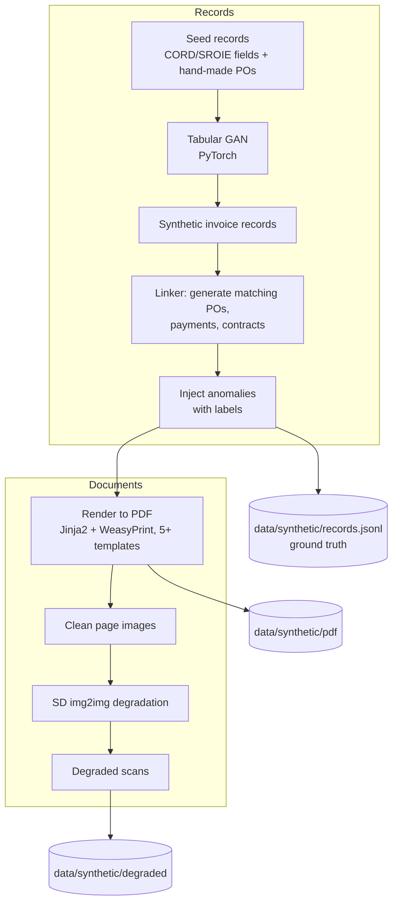

# Layer 7 · Synthetic Data (GAN + Diffusion)

**Code:** `ml/synthetic/` · **Phase:** 6b

## Purpose
1. **GAN** → realistic synthetic invoice *records* (amounts, quantities, dates, vendors) to
   populate POs/payments/contracts with known links and injected anomalies.
2. **Stable Diffusion img2img** → degraded *scan variants* (blur, stains, skew, fading)
   to stress-test OCR.

## Pipeline

## Part A — Tabular GAN (PyTorch)

**Features modelled:** `line_count`, `subtotal`, `tax_rate`, `total`, `days_to_due`,
`vendor_category` (categorical), `currency` (categorical), `day_of_month`, `qty_mean`, `unit_price_mean`.

| Component | Design |
|-----------|--------|
| Preprocessing | Log-transform amounts; min-max continuous; one-hot categoricals |
| Generator | MLP: noise(128) → 256 → 256 → features; Gumbel-softmax heads for categoricals |
| Discriminator | MLP with dropout; WGAN-GP loss for stability |
| Conditioning | Optional `vendor_category` condition (conditional GAN) |
| Training | Adam (lr 2e-4, β=(0.5, 0.9)), 5 critic steps per generator step |

**Quality checks (`ml/synthetic/gan/eval`):**
- Per-column distribution distance (KS statistic, Wasserstein).
- Correlation-matrix difference vs real.
- Business-rule validity: `total ≈ subtotal × (1 + tax_rate)` after post-processing (fix with deterministic recompute).
- "Train on synthetic, test on real" sanity check for the anomaly model.

### Anomaly injection (labels for layer 8)

| Type | How injected | Rate |
|------|-------------|------|
| Exact duplicate | Copy invoice, new id | 2 % |
| Near duplicate | Same vendor/amount, invoice no. ± 1, date ± 3 days | 2 % |
| Price inflation | Unit price +10–40 % over contract rate | 2 % |
| Round-amount | Total rounded to 1,000s, no line items | 1 % |
| Unknown vendor / no PO | Vendor not in master, PO missing | 1 % |
| Weekend/holiday date + rush terms | Due date ≤ 3 days | 1 % |

## Part B — Degraded scans (Stable Diffusion img2img)

| Setting | Value |
|---------|-------|
| Library | Hugging Face `diffusers`, `StableDiffusionImg2ImgPipeline` |
| Model | An SD 1.5 / SDXL checkpoint whose license allows this use |
| Prompts | "old photocopied invoice, coffee stain, faded toner", "crumpled paper scan, low contrast" |
| Strength | 0.2–0.45 (low enough to **preserve text** — higher values hallucinate characters) |
| Hardware | Colab/Kaggle GPU, fp16 |
| Plus classical augmentations | Rotation ±3°, Gaussian blur, JPEG artifacts, salt-and-pepper (via `albumentations`) |

**Validity check:** because diffusion can alter glyphs, run OCR on each variant and drop
images where key-field text from the ground truth is unrecoverable even by a human-check
sample. Keep a strength → CER curve.

**Output metric:** OCR character error rate (CER) and extraction F1 on clean vs degraded
sets, per OCR engine — shows robustness and guides preprocessing work.

## Definition of done
- `data/synthetic/records.jsonl` (~5k invoices + linked POs/payments/contracts, with anomaly labels).
- Rendered PDFs ingested successfully through the normal pipeline.
- GAN quality report + degraded-scan CER table in `eval/reports/`.
