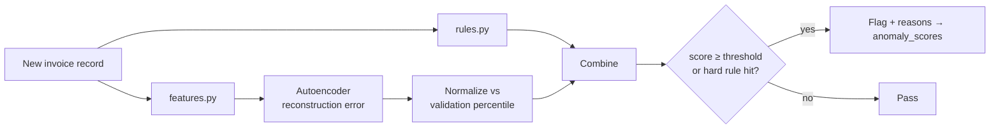

# Layer 8 · Anomaly Detection (TensorFlow / Keras Autoencoder)

**Code:** `ml/anomaly/` (training), `src/ledgerlens/anomaly/` (serving) · **Phase:** 6c

## Purpose
Flag duplicate or suspicious invoices with a **score and human-readable reasons**.
Combines deterministic rules (high precision) with an autoencoder (catches unusual patterns).

## Scoring flow



## Rules (`rules.py`)

| Rule | Logic |
|------|-------|
| Exact duplicate | Same vendor + invoice number, or same file SHA-256 |
| Near duplicate | Same vendor, \|Δ total\| < 1 %, \|Δ date\| ≤ 7 d, fuzzy invoice-no. similarity > 0.85; also adds `POSSIBLE_DUPLICATE` edge in Neo4j |
| Over PO | Invoice total > PO remaining balance |
| Contract rate breach | Unit price > contract rate + tolerance |
| Unknown vendor | Vendor not in master list |

## Features (`features.py`)

| Group | Features |
|-------|----------|
| Amount | log(total), tax ratio, round-number flag, z-score vs vendor history |
| Timing | days invoice→due, weekday, day-of-month, days since last invoice from vendor |
| Structure | line count, mean/max unit price, has PO, has tax id |
| Vendor history | vendor invoice count, mean/std total (computed from Postgres) |
| Text (optional) | PCA-reduced (16-d) embedding of header chunk |

Scaling: `StandardScaler` fit on training data only; saved with the model.

## Model

```python
inputs = keras.Input(shape=(n_features,))
x = layers.Dense(64, activation="relu")(inputs)
x = layers.Dropout(0.1)(x)
x = layers.Dense(32, activation="relu")(x)
z = layers.Dense(8, activation="relu", name="bottleneck")(x)
x = layers.Dense(32, activation="relu")(z)
x = layers.Dense(64, activation="relu")(x)
outputs = layers.Dense(n_features)(x)
model = keras.Model(inputs, outputs)
model.compile(optimizer=keras.optimizers.Adam(1e-3), loss="mse")
```

- **Train on normal invoices only** (labels from synthetic data exclude injected anomalies).
- Early stopping on validation reconstruction loss.
- Threshold: chosen on a labeled validation set to hit a target precision (e.g. ≥ 0.8), or the 99th percentile of normal-invoice error if unlabeled.
- **Reasons:** top-3 features by per-feature reconstruction error → "total unusually high for this vendor", etc.
- Save as `.keras` + scaler + threshold + version in `models/anomaly/<version>/`.

## Evaluation (`ml/anomaly/evaluate.py`)
- PR-AUC, ROC-AUC, precision@k, recall per anomaly type (from synthetic labels).
- Compare against baselines: rules only, Isolation Forest, rules + autoencoder.

| Method | PR-AUC | Recall (dupes) | Recall (price) | Precision@50 |
|--------|--------|----------------|----------------|--------------|
| Rules only | | | | |
| Isolation Forest | | | | |
| Autoencoder | | | | |
| **Rules + AE** | | | | |

## Serving
- `scorer.py` loads the model once per worker; exposed via MCP tool `score_anomaly` and
  run automatically at the end of ingestion.
- Dashboard "Anomalies" page lists flags with reasons; reviewer marks *confirmed* / *false positive* — stored for future retraining.

## Definition of done
- Model + scaler + threshold versioned; metrics table filled.
- Ingestion writes `anomaly_scores` for every invoice.
- Reasons shown in the dashboard.
