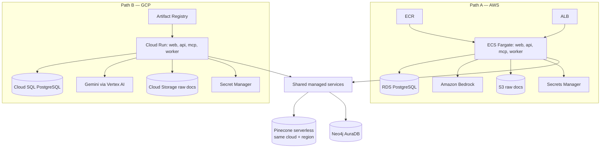

# Layer 10 · Deployment

**Code:** `infra/`, `.github/workflows/`, `web/` · **Phase:** 8

## Purpose
Package everything into containers, run it locally with one command, and deploy to
**AWS (with Bedrock)** or **GCP Cloud Run (with Gemini)** through GitHub Actions.

## Services

| Service | Image | Port | Notes |
|---------|-------|------|-------|
| `web` | `infra/docker/web.Dockerfile` (Next.js standalone) | 3000 | Talks to `api` only |
| `api` | `infra/docker/api.Dockerfile` (FastAPI + uvicorn) | 8000 | Runs LangGraph |
| `mcp` | `infra/docker/mcp.Dockerfile` | 8100 | MCP over streamable HTTP |
| `worker` | `infra/docker/worker.Dockerfile` | — | Ingestion queue consumer |
| `postgres` | `postgres:16` | 5432 | Local only (RDS / Cloud SQL in cloud) |
| `neo4j` | `neo4j:5` | 7474 / 7687 | Local only (AuraDB in cloud) |
| `pinecone-local` | Pinecone Local emulator | — | Local/CI only; real Pinecone in cloud |
| `ollama` | `ollama/ollama` | 11434 | Local Llama 3 + fine-tuned model |
| `redis` | `redis:7` | 6379 | Job queue |

## docker-compose.yml (sketch)

```yaml
services:
  api:
    build: { context: ., dockerfile: infra/docker/api.Dockerfile }
    env_file: .env
    ports: ["8000:8000"]
    depends_on: [postgres, neo4j, redis, mcp]
  worker:
    build: { context: ., dockerfile: infra/docker/worker.Dockerfile }
    env_file: .env
    depends_on: [postgres, neo4j, redis]
  mcp:
    build: { context: ., dockerfile: infra/docker/mcp.Dockerfile }
    env_file: .env
  web:
    build: { context: ./web, dockerfile: ../infra/docker/web.Dockerfile }
    environment: { NEXT_PUBLIC_API_URL: http://localhost:8000 }
    ports: ["3000:3000"]
  postgres:
    image: postgres:16
    environment: { POSTGRES_USER: ledger, POSTGRES_PASSWORD: ledger, POSTGRES_DB: ledgerlens }
    volumes: [pgdata:/var/lib/postgresql/data]
  neo4j:
    image: neo4j:5
    environment: { NEO4J_AUTH: neo4j/change-me }
    volumes: [neo4jdata:/data]
  redis:
    image: redis:7
  ollama:
    image: ollama/ollama
    volumes: [ollama:/root/.ollama]
volumes: { pgdata: {}, neo4jdata: {}, ollama: {} }
```

Dockerfile practices: multi-stage builds, `uv sync --frozen --no-dev`, non-root user,
model weights **not** baked into images (downloaded to a volume / cache at start).

## Dashboard (Next.js)

| Page | Shows |
|------|-------|
| `/` Overview | Docs ingested, unpaid total, overdue count, flagged invoices, cost/day |
| `/documents` | Upload (drag-and-drop), status, extracted fields side-by-side with the PDF |
| `/chat` | Streaming agent answers, tool-call timeline, clickable citations |
| `/anomalies` | Flag list, score, reasons, confirm / false-positive |
| `/reminders` | Draft queue, edit, approve / reject |
| `/eval` | Latest eval metrics + trend |

## Cloud targets



| Concern | AWS | GCP |
|---------|-----|-----|
| Compute | ECS Fargate (or App Runner for simplicity) | Cloud Run |
| LLM default (`smart`) | Bedrock (Converse API) | Gemini (Vertex AI) |
| Llama 3 in cloud | Llama models on Bedrock | Vertex Model Garden, or keep local-only |
| Fine-tuned model | Optional GPU instance / SageMaker; demo can run locally | Optional GPU Cloud Run / GCE |
| Postgres | RDS | Cloud SQL |
| Graph | Neo4j AuraDB (free tier for demo) | Neo4j AuraDB |
| Vectors | Pinecone index in AWS region | Pinecone index in GCP region |
| Secrets | Secrets Manager | Secret Manager |
| IaC | `infra/aws/` Terraform | `infra/gcp/` Terraform |
| CI auth | GitHub OIDC → IAM role | GitHub OIDC → Workload Identity Federation |

Pick **one** path for the live demo (cost); keep the other as working IaC + docs.

## GitHub Actions

| Workflow | Trigger | Steps |
|----------|---------|-------|
| `ci.yml` | PR, push | ruff, mypy, pytest unit, compose-based integration tests, web lint/build |
| `eval.yml` | PR touching retrieval/agents/prompts | Golden-set subset, regression gate, PR comment |
| `build.yml` | push to `main` | Build images, tag with git SHA, push to ECR / Artifact Registry |
| `deploy-aws.yml` / `deploy-gcp.yml` | tag `v*` or manual | Terraform plan/apply, run migrations, update services, smoke test `/health` |

## Production checklist
- [ ] Secrets only in secret manager; none in images or repo
- [ ] Postgres migrations run as a one-off job before rollout
- [ ] Health + readiness endpoints check Postgres, Neo4j, Pinecone
- [ ] Upload size/type limits; malware scanning optional
- [ ] Basic auth (e.g. NextAuth or API key) on the demo
- [ ] Rate limiting on `/chat`
- [ ] Budget alerts on cloud + LLM provider accounts
- [ ] Tracing enabled in prod (sampled)

## Definition of done
- `docker compose up` brings up the full stack locally.
- Tag push deploys to the chosen cloud; smoke test passes.
- Public demo URL in README with seeded demo data.
