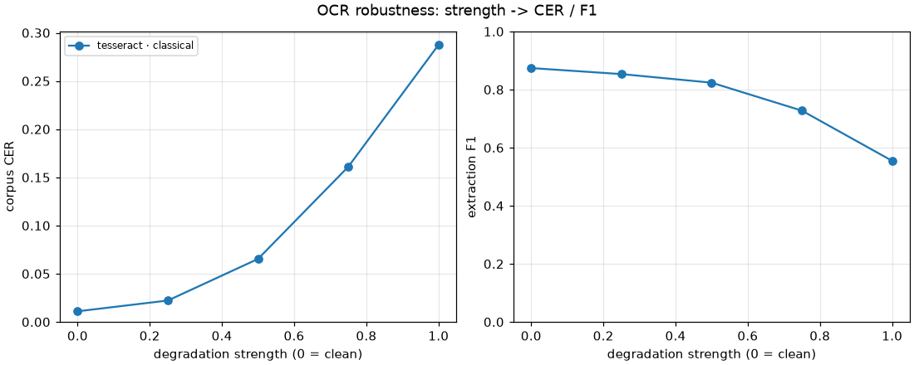

# OCR robustness: clean vs degraded scans — 2026-11-14

Phase 6b exit benchmark. **Pages:** the 300 rendered synthetic invoice pages from Day 23
(150 dpi grayscale, three layouts), each degraded by the classical augmentations of
Day 24 at severity 0.25 / 0.5 / 0.75 / 1.0, giving **1,500 page images**. **Engine:**
Tesseract 5.5 (`--psm 6`, min confidence 40), run in a local Docker image with the same
apt Tesseract as CI.

```
python -m ml.synthetic.diffusion.augment data/synthetic/pages/invoice --severities 0.25 0.5 0.75 1.0
python -m eval.ocr_robustness data/synthetic     --variants data/synthetic/degraded/classical/manifest.jsonl --engines tesseract paddle     --report eval/reports/2026-11-14/ocr_degraded.md --json ... --plot ...
```

**Scores.**
- **CER** is measured against the page's own PDF text layer, read through ingestion's
  line grouping so both sides share a reading order, with separator lines dropped.
- **Extraction F1** is the rules extractor on the OCR text, given the true document type
  (so it moves with OCR quality only), against the ledger record.
- **Key fields readable** is the share of pages whose invoice number, PO number and total
  are all read exactly. This is the Day 24 validity filter.

## Results (tuned preprocessing)

| Engine | Method | Strength | Pages | Corpus CER | Median CER | Extraction F1 | F1 vs clean | Key fields readable | Median s/page | Failed |
|---|---|---:|---:|---:|---:|---:|---:|---:|---:|---:|
| tesseract | clean | 0.00 | 300 | 0.011 | 0.005 | 0.874 | 100% | 100% | 1.43 | 0 |
| tesseract | classical | 0.25 | 300 | 0.022 | 0.019 | 0.853 | 98% | 89% | 1.45 | 0 |
| tesseract | classical | 0.50 | 300 | 0.065 | 0.049 | 0.824 | 94% | 85% | 1.51 | 0 |
| tesseract | classical | 0.75 | 300 | 0.161 | 0.055 | 0.727 | 83% | 67% | 1.28 | 0 |
| tesseract | classical | 1.00 | 300 | 0.288 | 0.226 | 0.555 | 63% | 33% | 1.22 | 0 |
| paddle | — | — | — | — | — | — | — | — | — | skipped: paddleocr is not installed; `pip install paddlepaddle paddleocr` or set ocr.engine: tesseract |



Machine-readable numbers: [ocr_degraded.json](ocr_degraded.json).

- **Clean OCR is near-perfect** (CER 0.011, every key field readable on all 300 pages).
- **Graceful up to severity 0.5** (±1.5° skew, σ 0.75 px blur, JPEG q60, 1 % speckle):
  CER 0.065, extraction F1 94 % of clean.
- **The cliff is between 0.75 and 1.0.** At full severity a third of pages still yield
  every key field exactly, so a production pipeline should route such scans to the LLM
  extractor or to human review rather than trust them.
- Median CER stays far below corpus CER at 0.75–1.0. The damage concentrates in a minority
  of pages: the modern layout's white-on-dark banner and "Amount due" bar are the first
  thing lost.

## What the tuning changed (`fix(ocr)` on this branch)

Same 1,500 images, previous preprocessing (deskew → full median on every page) vs
tuned (denoise only speckled pages, before deskew: light speckle → `despeckle` replaces
isolated pixels only; heavy speckle, isolated-pixel share ≥ 0.005 → full 3×3 median):

| Severity | Corpus CER | Extraction F1 | Key fields readable |
|---|---:|---:|---:|
| clean | 0.050 → **0.011** | 0.776 → **0.874** | 77% → **100%** |
| 0.25 | 0.019 → 0.022 | 0.852 → 0.853 | 97% → 89% |
| 0.5 | 0.115 → **0.065** | 0.782 → **0.824** | 72% → **85%** |
| 0.75 | 0.222 → **0.161** | 0.660 → **0.727** | 47% → **67%** |
| 1.0 | 0.426 → **0.288** | 0.412 → **0.555** | 14% → **33%** |

Numbers for the previous pipeline: [ocr_degraded_before.json](ocr_degraded_before.json).

- The median filter ate thin strokes on clean 150-dpi pages. Denoising only speckled
  pages took clean CER from 0.050 to 0.011.
- Deskewing first smeared each speck into a grey blob no filter could remove.
  Denoising first cut CER by about a third at severities 0.5–1.0.
- Light speckle gets `despeckle`, which replaces only isolated pixels and leaves strokes
  untouched. A full median there eroded the scanned receipt fixture's "Receipt" into
  "Recemt", so it was classified `unknown`. That broke the CI integration tests on the
  first version of this branch. With `despeckle` the receipt reads correctly (CER
  0.053 → **0.012**).
- **Trade-off:** at light synthetic noise (severity 0.25–0.5), `despeckle` leaves specks on
  grey anti-aliased edges that a full median removed. CER is unchanged (0.020 vs 0.022 at
  0.25), but key fields are fully readable on 89 % of pages instead of 98 % (85 % vs 89 % at
  0.5). At 0.25 that is also below the original pipeline (97 %): the one row in the table
  above that got worse. The two cases cannot be told apart by speckle level: the receipt (0.0041) is
  *noisier* than severity 0.25 (≤ 0.0029). So this keeps the stroke-preserving filter,
  because it gets real documents classified, and leaves a smarter light-speckle filter
  as follow-up work.
- Also measured on a 40-page subset and rejected: Otsu binarization (worse everywhere)
  and upscaling 150-dpi pages ×2 (better at 0.5, but worse on clean pages and at
  0.75–1.0).

## Not covered by this run

- **Stable Diffusion img2img variants:** not generated. This machine has no GPU, and the
  Colab notebook (`ml/synthetic/diffusion/notebooks/degrade.ipynb`) has not been run yet.
  Once it has, pass its `validity.jsonl` as a second `--variants` (with `--kept-only`) and
  the SD strength curve joins this table and plot.
- **PaddleOCR:** reported as skipped. It has no wheels for this environment, so the
  per-engine comparison is Tesseract only.
